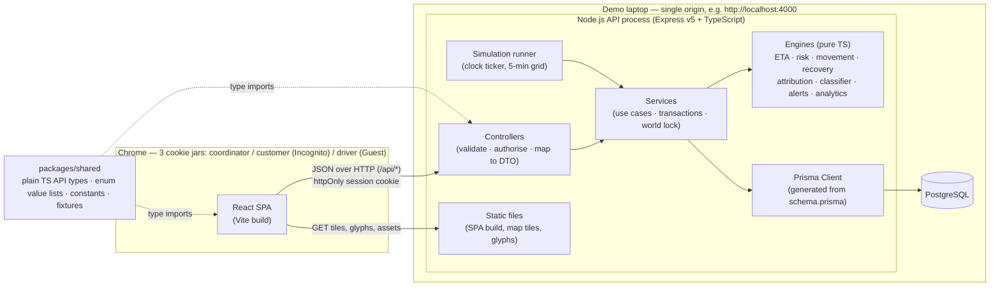
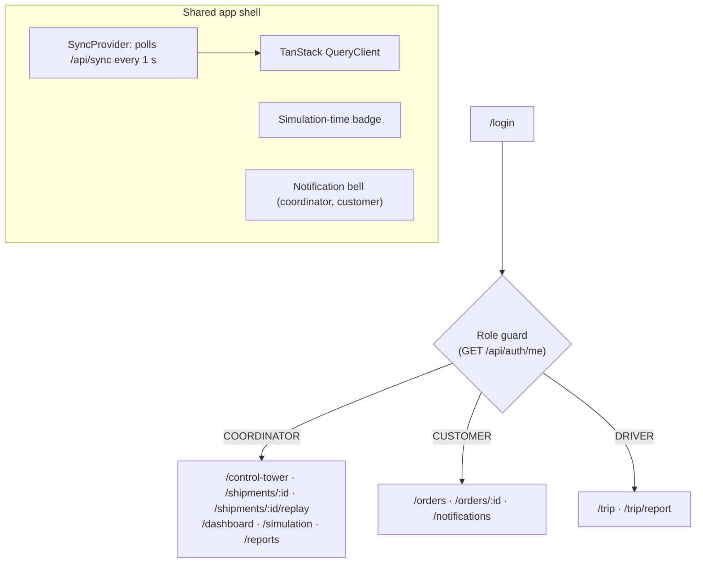
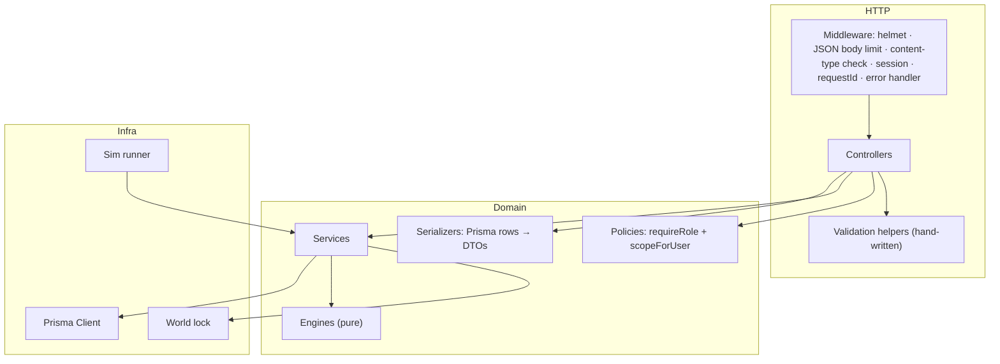
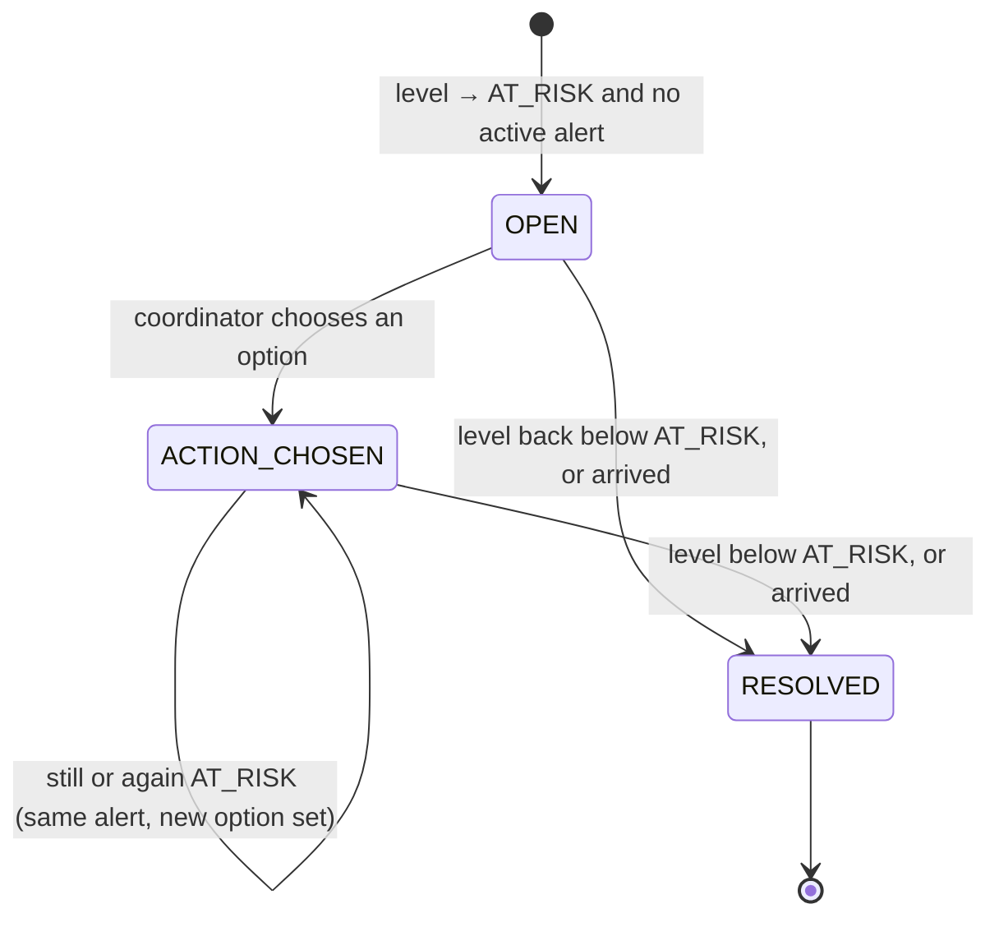
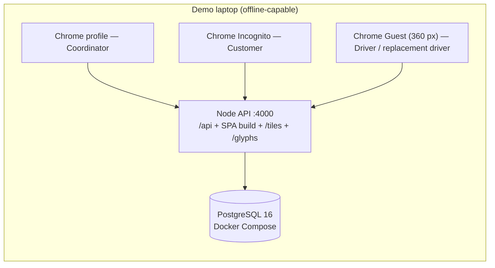

# 04 — Technical architecture: RoutePulse

Version 0.3, 2026-11-12. Status: **approved; revision 0.3 records the locked decisions L1–L10** (§0.1).
Inputs: `02_PRODUCT_SPEC.md` (spec), `03_USER_JOURNEYS.md` (journeys). References like "spec §5.4" and AC-IDs point to those documents. The approved documents are **not** changed here. Where this design needs an interpretation, it is listed in §19.

Companion documents: `05_DATABASE_SCHEMA.md` (schema), `06_API_SPEC.md` (API contracts).
Diagrams use Mermaid (renders in GitHub and in VS Code with a Mermaid preview).

Labels: **[A]** assumption · **[DECIDED]** team decision, with date · **[OPEN]** needs a team decision · **[VERIFY]** check against official docs at setup (library details were not verified in this session).

---

## 0. Decision record

| # | Decision | Date | Where applied |
|---|---|---|---|
| D1 | Backend framework: **Express v5 with TypeScript**. | 2026-11-12 | §3, §6 |
| D2 | Demo uses **three separate Chrome cookie jars** (normal profile, Incognito, Guest) for coordinator, customer and driver. | 2026-11-12 | §7.1, §15 |
| D3 | Replacement-truck scenarios use a **second seeded driver**. The driver window switches to that driver's account to show the hand-over. | 2026-11-12 | §12, schema seed, API §9 |
| D4 | On-time is measured against the **agreed** promise (arrival-based, L1). Renegotiated shipments are reported separately. | 2026-11-12 | §10.4, schema `Shipment`, API §13 |
| D5 | Route geometry from a **one-time open routing export** before the build. GeoJSON basemap fallback is kept. | 2026-11-12 | §16 |
| D6 | Transporter history delay (HIST) is **prorated by remaining baseline route time**. | 2026-11-12 | §10.3 |
| D7 | **Background shipments move automatically** in the deterministic simulation. The **hero shipment is manually controlled**. | 2026-11-12 | §9.3 |
| D8 | **Shared coordinator notification read state** is accepted for the prototype. | 2026-11-12 | §11 |
| D9 | **No Zod and no other schema-validation library.** `schema.prisma` is the single source of truth for database models, fields, relations, enums, indexes and constraints. API contracts are plain TypeScript types. Request validation is hand-written. | 2026-11-12 | §1, §4, §8, schema, API |

### 0.1 Locked decisions (decision-lock review, 2026-11-12)
Labelled D1–D10 in that review; recorded here as **L1–L10** so they do not clash with D1–D9 above.

| # | Decision | Where applied |
|---|---|---|
| L1 | **Promise measured at arrival at the customer's receiving gate.** `predictedArrivalAt` = estimated arrival at the receiving gate; `arrivedAt` = actual arrival at the receiving gate; `deliveredAt` = unloading complete; on-time = `arrivedAt ≤ promisedBy`. Receiving-window eligibility is decided by arrival time. Unloading may finish after the window closes if arrival was inside it. ARRIVED and DELIVERED stay separate milestones. | §10.1, §10.4, spec §5.3–5.4, schema `Shipment`, API §13 |
| L2 | **RESET prepares the demo at Thu 10:25, paused:** deterministic seed, then the hero pre-script executed through the real simulation services, then advance to 10:25. No shortcut simulation. | §9.5, §9.6, journeys J9 |
| L3 | **Four-term ETA identity:** ETA = Planned + Incurred (I) + Plan change (P) + Expected (E); P = 0 without a reroute. | §10.2 |
| L4 | **NEW_WINDOW uses a shipment-specific receiving-window override.** Customer default hours and the original promise are never modified. The accepted window is stored on the shipment and applied only to it. ETA, WIN, slack and risk recalculate after acceptance. Preview and execution use the same override; stale options cannot be applied. | §10.1, §12, schema `Shipment`, API §10 |
| L5 | **Overlaps:** latest-ending stop wins; largest slowdown wins; a stop takes precedence over a slowdown; all disruption events are kept in history; effective delay is booked once; settlement and projection use the same precedence. | §10.5 |
| L6 | **Arrival confirmation:** physical arrival, driver-confirmed ARRIVED and DELIVERED are separate. Waiting for a manual confirmation never becomes transport delay and never changes the ETA or on-time result after physical arrival. | §9.3, §10.1, §10.5 |
| L7 | **Activity feed reuses `GET /api/audit`** with its existing filters; no new endpoint. | §17, UI plan §6.5 |
| L8 | **Relational schema retained;** no conversion of entities to JSON (schema simplification S-1 rejected). | Schema §2.3 |
| L9 | **Frontend dependencies approved:** React, Vite, TypeScript, Tailwind CSS, Radix UI, TanStack Query, React Router, Recharts, MapLibre GL JS, lucide-react; Inter self-hosted. Not installed during the documentation phase. | §3 |
| L10 | **Gated features stay disabled:** CO₂e until factors and method are verified (G-CO2); second language until translations are verified (G-LANG). | §12, UI plan |

---

## 1. Architectural principles

1. **One source of truth for state: the API server and its database.** Every screen reads server state. No business rule runs only in the browser.
2. **One source of truth for the data model: `schema.prisma`.** Database entities, enums, relations, indexes and constraints are defined there (plus the raw-SQL constraints listed next to it). Prisma Client generates the database TypeScript types.
3. **Pure engines, thin routes.** Business rules (ETA, risk, movement, recovery, attribution, classification, analytics) are pure TypeScript functions with no database, HTTP or clock access. Services load data, call engines and write results. Controllers only validate input, authorise, call one service and map the result to a response DTO.
4. **Database models are not API responses.** Every response is built by a serializer into a declared DTO type. Prisma entities are never sent to the client directly.
5. **Deterministic by construction.** Simulation time only, a fixed 5-minute grid, integer seconds in the ledger, no runtime randomness (§9).
6. **Rule-based and explainable.** Every number can be traced to a named rule and its inputs. Nothing is described as machine learning.
7. **Offline demo path.** No external network request while the demo runs (§16).
8. **Access control on the server.** Role checks, row scoping and field filtering happen in the API (§7).
9. **Contract-first collaboration without a schema library.** A shared package holds plain TypeScript request/response types. Both developers build against it (§8).
10. **Smallest thing that works.** One API process, one database, polling instead of sockets, no queue, no cache server, no extra frameworks.

---

## 2. Overall system architecture



**How the parts talk to each other**
| From → To | Mechanism | Notes |
|---|---|---|
| SPA → API | JSON over HTTP, same origin, `/api/*` | Session cookie sent automatically. No CORS. |
| SPA → API (freshness) | Polling `GET /api/sync` every 1 s | Returns `worldVersion`; when it changes, the SPA refetches affected queries (§5.2). |
| Controllers → Services | Function call with validated, typed input | Controllers never touch Prisma. |
| Services → Engines | Function call with plain data objects | Engines never touch Prisma, HTTP or the clock. |
| Simulation runner → Services | Function call per grid boundary | Runs inside the API process. |
| Services → DB | Prisma Client, inside transactions | All mutations go through one in-process world lock (§9.7). |
| Shared package → SPA and API | TypeScript type imports (npm workspace) | Same request/response types on both sides. No runtime schema library. |

---

## 3. Technology choices

| Layer | Choice | Why | Status |
|---|---|---|---|
| Language | TypeScript (strict) everywhere | Approved stack; shared types | Approved |
| Frontend | React + Vite (SPA) | Approved stack; static build served by the API | **[DECIDED L9]** |
| Backend runtime | Node.js LTS | Prisma requires a Node backend | Implied by stack |
| Backend framework | **Express v5** | Smallest familiar option; serves SPA and tiles from the same origin | **[DECIDED D1]** |
| Request validation | **Hand-written validator helpers** in `apps/api/src/validation` | No schema library (D9) | **[DECIDED D9]** |
| ORM / DB | Prisma + PostgreSQL; `schema.prisma` is the data-model source of truth | Approved stack | Approved |
| Server state in UI | TanStack Query | Caching, refetch on `worldVersion`, loading/error states | **[DECIDED L9]** |
| Routing in UI | React Router | Role-based route trees | **[DECIDED L9]** |
| UI components | Tailwind CSS + Radix UI | Accessible primitives | **[DECIDED L9]** |
| Icons | lucide-react | One outline icon set, tree-shaken | **[DECIDED L9]** |
| Font | Inter, self-hosted woff2 | Offline | **[DECIDED L9]** |
| Charts | Recharts | Bar/line/stacked charts; our own table toggle | **[DECIDED L9]** |
| Map | MapLibre GL JS used directly; local basemap via PMTiles (spike §16.2) or the GeoJSON fallback (§16.3) | Open source, no key, offline | **[DECIDED L9]** (MapLibre) · **[OPEN]** the `pmtiles` browser library is not in the L9 list (§16.2) |
| Geometry | Turf `along` / `length` (server) | Position from route distance | **[A]** |
| Auth | bcrypt hashes + signed JWT in an httpOnly cookie | No session table | **[A]** |
| Tests | Vitest; integration tests call the real Express app on an ephemeral port with Node's built-in `fetch` (no extra HTTP test library) | Few dependencies | **[A]** |
| Local DB | PostgreSQL in Docker Compose (or a local install) | No cloud dependency in the demo | **[A]** |

Dependencies deliberately **not** used: Zod or any schema-validation library (D9), any second backend framework, WebSocket libraries, Redis/queues, HTTP test libraries.

---

## 4. Repository structure (npm workspaces)

```
/
├─ apps/
│  ├─ web/                        React SPA (Developer B owns)
│  │  └─ src/
│  │     ├─ app/                  router, providers, role guards
│  │     ├─ features/             coordinator/, customer/, driver/, dashboard/, replay/, simulation/
│  │     ├─ components/           design-system components
│  │     ├─ map/                  map view, layers, markers
│  │     ├─ api/                  typed fetch client + one TanStack Query hook per endpoint
│  │     └─ i18n/                 message dictionary (English; second language only if G-LANG passes)
│  └─ api/                        Express API (Developer A owns)
│     ├─ prisma/
│     │  ├─ schema.prisma         ← single source of truth for the data model (D9)
│     │  ├─ migrations/           generated SQL + hand-added CHECKs / partial indexes
│     │  └─ seed/                 deterministic seed + hero pre-script (§9.6)
│     └─ src/
│        ├─ controllers/          one file per resource; validate → authorise → service → serializer
│        ├─ validation/           hand-written helpers (§8.2); enum lists from Prisma Client
│        ├─ services/             use cases; transactions; world lock
│        ├─ engines/              pure functions (no Prisma, no Express, no Date.now, no Math.random)
│        ├─ sim/                  clock ticker and settle/step runner
│        ├─ auth/                 login, session cookie, role middleware, scope helpers
│        ├─ serializers/          Prisma rows → API DTOs (typed with packages/shared)
│        ├─ guards/               hand-written runtime guards for Prisma Json columns (§8.4)
│        ├─ contract-checks.ts    compile-time checks: shared enum unions ≡ Prisma enums (§8.3)
│        ├─ config/               thresholds, default minutes, rate card, CO₂ factor (null until G-CO2)
│        └─ errors/               error classes and error middleware
├─ packages/
│  └─ shared/                     API contract (both developers; changes need a note to the other)
│     └─ src/
│        ├─ enums.ts              string-literal unions + `as const` value arrays mirroring schema.prisma enums
│        ├─ api/                  request/response interfaces per resource (06_API_SPEC.md §2–§14)
│        ├─ constants.ts          plant location, display thresholds, UI-safe config
│        └─ fixtures/             example responses typed with `satisfies` (frontend builds before the API)
├─ docker-compose.yml             PostgreSQL
└─ package.json                   workspaces + scripts: dev, build, typecheck, test, demo, seed, reset
```

**Ownership boundary:** Developer A owns `apps/api` and `schema.prisma`. Developer B owns `apps/web`. `packages/shared` is the contract; any change to it needs a short note to the other developer. `packages/shared` has **no runtime dependencies** and does **not** import `@prisma/client` (it is bundled into the browser).

---

## 5. Frontend architecture

### 5.1 Structure

- Three route trees in one SPA; the role guard improves UX only — the server enforces access.
- Driver layout is mobile-first (360 px). Coordinator layout is desktop-first. Customer layout works at both.
- One typed hook per endpoint in `src/api/`. Response types come from `packages/shared`. Components never call `fetch` directly.
- No global client store. Server state lives in TanStack Query; UI state lives in components or the URL.

### 5.2 Freshness model
1. `SyncProvider` calls `GET /api/sync` every 1 s → `simTime`, `running`, `speed`, `worldVersion`, `unreadNotifications`, `simError`.
2. If `worldVersion` changed, invalidate the query keys listed in API spec §15.
3. While the clock runs, `GET /api/tracking/positions` refetches every 1 s; markers animate between server positions (smoothing only).
4. A driver milestone reaches the other windows within ~1–2 s (AC-M2.5 asks ≤ 5 s).

### 5.3 UI states
Every data view has designed loading, empty, error and conflict states (spec §9). `409 STALE_OPTIONS` shows "Options changed — review the updated cards".

---

## 6. Backend architecture

### 6.1 Layers


| Layer | Responsibility | May import | Must not |
|---|---|---|---|
| Controllers | Shape validation of params/query/body (§8.2), `requireRole`, call one service, pass the result to a serializer | validation, services, policies, serializers, shared types | Prisma, engines |
| Policies | `requireRole(...)`; `scopeForUser(user)` → Prisma `where` fragment | Prisma types | Express objects |
| Services | Use cases; **business-rule validation** (state transitions, feasibility, ownership); transactions; events/audit; `worldVersion` | engines, Prisma Client, policies | Express `req`/`res` |
| Engines | Pure calculations | shared types, config | Prisma, Express, `Date.now()`, `Math.random()` |
| Serializers | Build DTOs with explicit field picks; drop internal and role-restricted fields | Prisma types, shared types | Writes |
| Sim runner | Advance the clock; call `simulationService.settleTo()` | services | — |

### 6.2 Services
`authService` · `simulationService` · `disruptionService` · `shipmentService` · `etaService` · `alertService` · `recoveryService` · `reportService` · `attributionService` · `notificationService` · `analyticsService` · `auditService` · `referenceService`.

### 6.3 One recalculation pipeline
```mermaid
sequenceDiagram
  autonumber
  participant T as Trigger (grid step / action)
  participant L as World lock
  participant SIM as simulationService
  participant ES as etaService
  participant EN as Engines
  participant AS as alertService
  participant RS as recoveryService
  participant DB as PostgreSQL
  T->>L: acquire
  L->>SIM: settleTo(actionTime or boundary)
  SIM->>DB: movement + ledger seconds for (lastSettledAt → t]
  opt action
    SIM->>DB: apply action (report / disruption / recovery / milestone)
  end
  SIM->>ES: recalculate(all live shipments, t, trigger)
  ES->>EN: projectEta(context) per shipment
  EN-->>ES: EtaResult (factors, ETA, range, level, score, confidence)
  ES->>DB: cached fields on Shipment; RiskSnapshot if rule says so
  ES->>AS: evaluate(previous level, new level)
  AS->>DB: Alert / Notifications / firstAtRiskAt / customerNotifiedAt
  ES->>RS: refresh option set (WATCH or AT_RISK)
  RS->>DB: new RecoveryOption set; old set SUPERSEDED
  SIM->>DB: SimState (simTime, lastSettledAt, worldVersion if material change)
  L-->>T: release
```

---

## 7. Authentication and authorisation

### 7.1 Authentication
- `POST /api/auth/login` with email + password; bcrypt hashes (cost 10); seeded fictional `.test` accounts.
- Cookie `rp_session`: httpOnly, SameSite=Lax, signed JWT (HS256) with `sub`, `role`, `exp` (8 h); `Secure` over HTTPS; secret `SESSION_SECRET` in a gitignored `.env`.
- Logout clears the cookie (AC-M1.5). No server-side revocation list (prototype limit, §14).
- Login rate limit 10/min/IP — implemented as a small in-memory counter (no extra dependency).
- **Stable user ids** across demo resets, so open sessions stay valid.
- **Demo [DECIDED D2]:** three Chrome cookie jars — normal profile (coordinator), Incognito (customer), Guest (driver, 360 px). For the hand-over (D3), the Guest window logs out of `driver.ramesh@…` and logs in as the replacement driver.

### 7.2 Authorisation — three layers, all on the server
1. **Role (what endpoint):** `requireRole(...)` per route, from the role matrix in spec §4.
2. **Scope (which rows):** `scopeForUser(user)`: COORDINATOR → all · CUSTOMER → `order.customerId = user.customerId` · DRIVER → `shipment.driverUserId = user.id`. Out-of-scope id → **404 `NOT_FOUND`** (AC-M1.4).
3. **Fields (what data):** serializers per role. Customer DTOs never contain driver name/phone, party labels, internal factor codes or other customers' data (AC-M1.6).

---

## 8. API contracts and validation without a schema library [DECIDED D9]

### 8.1 Three kinds of types, three homes
| Kind | Source of truth | Used by |
|---|---|---|
| Database entities, enums, relations, indexes, constraints | `apps/api/prisma/schema.prisma` (+ raw-SQL constraints in the migration) | Prisma Client generates TS types (`Shipment`, `Prisma.ShipmentGetPayload<…>`, enum objects). API only. |
| API request / response contracts (DTOs) | `packages/shared/src/api/*.ts` — plain `interface` / `type` | API controllers + serializers; SPA hooks |
| Enum values visible in the API | `schema.prisma` enums, **mirrored** in `packages/shared/src/enums.ts` as `as const` arrays + unions | SPA (no Prisma in the browser); API validation uses Prisma's own enum objects |

### 8.2 Request validation (hand-written)
- **Where:**
  - **Controllers** validate *shape*: required fields present, types correct, enum values allowed, lengths and number ranges, ISO date strings, no unknown fields.
  - **Services** validate *business rules*: state transitions (next milestone only), feasibility (truck still free), ownership/scope, option set still current.
- **How:** a small set of helpers in `apps/api/src/validation/` (≈ 100 lines, no dependency). Each takes `unknown`, returns a typed value, and records an issue `{ path, message }` on failure:
  `obj(body, allowedKeys)` · `str(v, {min, max, trim})` · `optStr` · `int(v, {min, max, multipleOf})` · `optInt` · `bool` · `oneOf(v, values)` · `optOneOf` · `isoDateTime(v)` · `arrayOf(v, itemFn, {min, max})` · `literalTrue(v)` · `queryList(v)` (repeated query params) · `queryBool(v)` (`'true' | 'false'`).
- **Enum values come from Prisma Client**, so validation can never drift from `schema.prisma`: e.g. `oneOf(input.reason, Object.values(ReasonCode))` with `ReasonCode` imported from `@prisma/client`. Subsets (e.g. driver-chip reasons, driver-recordable milestones) are defined once in API config.
- **Unknown body fields → 400**, to catch contract drift early.
- **Collect, then fail:** a controller runs all checks, then throws one `ValidationError` with every issue → `400 VALIDATION_ERROR` with `details: ValidationIssue[]`.
- **Prisma does not validate HTTP input.** Prisma only enforces types at compile time and constraints at the database. The database CHECKs and unique indexes are a last line of defence, mapped to `409 CONFLICT` / `500` if ever hit; they are not the validation layer.
- The per-endpoint rules are listed in `06_API_SPEC.md`.

### 8.3 Keeping backend and frontend types consistent (no extra layer)
1. **Single contract package:** controllers declare their response type from `packages/shared` (`res.json(dto satisfies ShipmentDetailResponse)`), and the SPA's typed fetch client uses the same type. A change in one place breaks the other at compile time.
2. **Serializers are typed both ways:** input is a Prisma payload type (`Prisma.ShipmentGetPayload<{ select: … }>`), output is the shared DTO. Prisma queries use explicit `select`, so internal fields are never loaded into a response by accident.
3. **Enum drift check (compile-time):** `apps/api/src/contract-checks.ts` asserts that each shared union equals the Prisma enum type (e.g. `Equals<SharedRiskLevel, PrismaRiskLevel>`); `npm run typecheck` fails on drift. A unit test also compares the shared `as const` arrays with `Object.values()` of the Prisma enum objects.
4. **Fixtures are typed:** every fixture uses `satisfies <ResponseType>`, so fixtures break when the contract changes.
5. **Integration tests** (§20.2) call real endpoints and assert key response fields, which catches serializer mistakes the type system cannot (e.g. a field set to the wrong value).
6. **One command:** `npm run typecheck` runs `tsc --noEmit` across all workspaces; it is part of `npm test`.

Accepted trade-off: the SPA trusts that responses match the declared types (a type assertion at the fetch boundary). Mitigations are points 2, 3 and 5.

### 8.4 Prisma `Json` columns
Prisma types `Json` columns as `JsonValue`. For each one (`Route.geometry`, `Route.segments`, `RiskSnapshot.factors`, `RecoveryOption.params`, `Notification.params`, `ShipmentEvent.data`, `AuditLog.data`) the API has:
- a TypeScript type (in `packages/shared` when it reaches the client, e.g. `Factor[]`, `Segment[]`; otherwise in the API);
- a **hand-written guard** in `apps/api/src/guards/` (e.g. `isSegmentArray`) used when writing in the seed and when reading before serialisation. A failing guard is a server bug → `500 INTERNAL` with a clear log line.

### 8.5 Conventions
JSON only; timestamps ISO 8601 UTC (displayed in Asia/Kolkata); durations integer minutes in the API (the ledger stores seconds internally, §10); money integer INR; weights in tonnes; error envelope `{ error: { code, message, details?, requestId } }`; state-changing endpoints return `409` on repeated or out-of-order requests.

---

## 9. Simulation engine and determinism

### 9.1 Clock state
| Field (`SimState`) | Meaning |
|---|---|
| `simTime` | Current continuous simulation time (millisecond precision while running; persisted on every settle and on pause). |
| `lastSettledAt` | The sim time up to which **movement and the delay ledger** have been computed. Invariant: `lastSettledAt ≤ simTime`. |
| `stepMinutes` | Grid size: 5. Grid boundaries are fixed: every time `t` with `t mod 5 min = 0` (from the seed epoch). |
| `running`, `speed` | Ticker on/off; 1×, 10× or 60×. |
| `worldVersion` | Monotonic counter; +1 per committed transaction that makes a **material change** (§9.5). Never reset. |

The in-memory copy of `simTime` is authoritative while the process runs; `GET /api/sync` returns it.

### 9.2 The settle operation (the only way state moves forward)
`settleTo(t)`: for every live shipment, advance movement and the ledger from `lastSettledAt` to `t`, **splitting the interval at every grid boundary and at every disruption start/end inside it**, then set `lastSettledAt = t`. Within each sub-interval the conditions are constant, so motion is linear:

- moving: `progressM += segmentSpeed × pace × (1 − slowdown) × Δt` (integer metres + carry), split across segment ends;
- stopped (`stoppedUntil`): no movement; whole Δt booked to the stopping cause;
- at gate/loading, at customer: queue and window rules (§9.3).

Arithmetic: distance in integer metres, time in integer seconds, ledger in integer seconds. Rounding rule: `floor` for metres per sub-interval, remainder carried in `Shipment.progressCarryMm` (persisted). With this carry, splitting an interval into two sub-intervals gives exactly the same total as one interval. This is what makes actions between boundaries safe.

### 9.3 What happens on a grid boundary (`step(b)`)
After `settleTo(b)`:
| Shipment state | Behaviour at a boundary |
|---|---|
| Before gate (autopilot) | If `plannedGateAt ≤ b`: record AT_GATE (source SIMULATION). |
| Before gate (manual / hero) | Wait for the driver's AT_GATE tap. |
| At gate | Queue served first-come by `gateQueuedAt`; when a bay is free, record LOADING (always by SIMULATION — LOADING is a plant activity for every shipment, §19 issue 16). |
| Loading finished (autopilot) | Record GATE_OUT and IN_TRANSIT. Gate-out is never earlier than `plannedDepartureAt` (the truck waits) — this keeps incurred delay ≥ 0. |
| Loading finished (manual) | Driver may now tap GATE_OUT; the system records IN_TRANSIT at the same time. |
| End of route (autopilot) | Record `physicalArrivalAt` (event PHYSICAL_ARRIVAL); record ARRIVED at the eligible check-in time (§10.1), `arrivedAt` = that time; record DELIVERED at `arrivedAt + unloadingMinutes` (source SIMULATION). |
| End of route (manual / hero, L6) | Record `physicalArrivalAt` (event PHYSICAL_ARRIVAL); the truck holds at the gate. From the eligible check-in time the driver may tap ARRIVED; `arrivedAt` = the eligible check-in time, **not** the tap time. From `arrivedAt + unloadingMinutes` the driver may tap DELIVERED; `deliveredAt` = `arrivedAt + unloadingMinutes` (+ any confirmed "waiting to unload" minutes), not the tap time. Waiting for a tap books nothing. |
| Pings (autopilot) | Every `pingIntervalMinutes`, set `lastUpdateAt = b`, unless inside a seeded `silentFrom` period. |
| Any live shipment | Recalculate ETA/risk (§10); snapshot if the snapshot rule fires (§9.5). |

Speed never exceeds the segment baseline speed (`pace ≤ 1`, slowdown ≥ 0): trucks never "catch up". This keeps every incurred delay ≥ 0 and the ledger additive.

### 9.4 Actions between grid boundaries
- An action (milestone, driver report, review, disruption, recovery choice, customer response) is stamped with **`actionTime = floor(simTime to the whole minute)`**, and never earlier than `lastSettledAt`.
- Under the world lock: `settleTo(actionTime)` → apply the action at `actionTime` → recalculate all live shipments at `actionTime` → commit.
- The grid does **not** move. The next boundary is still the next multiple of 5 minutes; `step(b)` then settles from `actionTime` to `b`.
- Because settle splits are exact (§9.2), an action at 11:07 gives the same later states whether the clock was running or paused at that moment. Results are fully determined by the **sequence of (actionTime, action)** pairs; every pair is recorded in `ShipmentEvent`/`AuditLog`.
- Presenter protocol for identical rehearsals: pause → `ADVANCE_TO` the scripted minute → act → play.

### 9.5 Clock controls and `worldVersion`
| Control | Behaviour |
|---|---|
| Ticker (running) | Every 250 ms real time (monotonic clock): `simTime += realElapsed × speed`; for every grid boundary `b ≤ simTime` with `b > lastSettledAt`: `step(b)` in order. |
| Long gap guard | If one tick would cross more than 12 boundaries (e.g. laptop sleep), process 12, **pause**, and set `simError = "Clock paused after a long gap"`. |
| `PAUSE` | Stop the ticker; keep `simTime` where it is (no snapping); persist. |
| `PLAY` | Resume from the current `simTime`; real-time delta starts at the resume moment (no jump). |
| `SET_SPEED` | While running: first advance `simTime` to now at the old speed, then switch. |
| `ADVANCE minutes` / `ADVANCE_TO t` | Implicitly pause; process every boundary up to the target in order; `settleTo(target)`; set `simTime = target`; leave paused. `ADVANCE 60` ≡ 12 × `ADVANCE 5`. |
| `RESET` | Pause; inside the lock: truncate, reseed (clock at the seed start, Thu 08:00), run the hero pre-script through the normal services (§9.6) and `ADVANCE_TO 10:25`; leave `running = false`, `speed = 1`; `worldVersion = previous + 1` (L2). |

**Material change** (→ `worldVersion += 1`, once per transaction): any `ShipmentEvent`, `RiskSnapshot`, alert/notification/option-set change, change of a shipment's cached `etaAt`, `riskLevel`, `confidence` or `currentMilestone`, disruption start/end, clock control, reset. Pure progress along the route is **not** material (positions have their own 1 s poll).

**Snapshot rule:** store a `RiskSnapshot` when the level changes, `etaAt` moves by ≥ 5 min, an action or milestone occurred, or 30 sim-minutes passed since the last snapshot of that shipment.

### 9.6 Seed and demo start
- The seed is deterministic (fixed-seed PRNG for the 60-day history; fixed ids).
- **Hero pre-script [DECIDED L2]:** after seeding (clock Thu 08:00), `RESET` calls the same services the API uses — no shortcut code path:
  1. `advanceTo(08:10)` → hero driver records AT_GATE (planned gate time; on time).
  2. All three bays are occupied by seeded background shipments until 08:50, so the simulation records LOADING for SHP-1042 at 08:50 (planned departure); waiting after 08:50 books GATE (PLANT).
  3. `advanceTo(09:30)` → loading complete → hero driver records GATE_OUT (IN_TRANSIT by system). GATE incurred = 40 min.
  4. `advanceTo(10:25)` → pause.
  Background shipments run on autopilot throughout. The resulting state (positions, ledger, snapshots for the replay) is identical after every reset because ids, seed and action times are fixed.
- Second driver for the hand-over (D3): a seeded driver of the same fictional transporter, default driver of the replacement truck (e.g. TRK-11, parked at a yard near the hero route).

### 9.7 Concurrency
All mutations (ticker steps and user actions) run through one in-process mutex, each inside one Prisma transaction. Reads take no lock. Valid because there is exactly one API process (§15).

### 9.8 Reproducibility test scenarios
| ID | Scenario | Pass condition |
|---|---|---|
| R1 | Run the hero script twice from `RESET` | Identical hash of all snapshots, ledger rows, alerts and options (ids excluded) |
| R2 | 11:00 → 11:10 in one step vs settle at 11:07 with a no-op action | Identical `progressM`, `progressCarryMm`, ledger seconds and ETA |
| R3 | Same script with different real-time pauses (ticker vs `ADVANCE_TO`) | Identical results |
| R4 | `ADVANCE 60` vs 12 × `ADVANCE 5` vs ticker at 60× for 60 real seconds (stopped exactly at the target with `ADVANCE_TO`) | Identical state at the target time |
| R5 | `SET_SPEED` changes during a run without actions | Identical state at a given sim time as a constant-speed run |
| R6 | Driver report at 11:10 while running vs while paused | Identical results (action time is the same minute) |
| R7 | `RESET` twice | Identical database digest at Thu 10:25 (paused); `worldVersion` strictly increased; open sessions still valid |
| R8 | Long-gap guard | > 12 boundaries in one tick → exactly 12 processed, clock paused, `simError` set |

Tests drive `simulationService` directly with explicit times; the real-time ticker is a thin wrapper and is not needed for determinism tests.

---

## 10. ETA, delay attribution and the identity

### 10.1 Definitions
- **Arrival terms [DECIDED L1, L4, L6]:**
  | Term | Meaning |
  |---|---|
  | Road arrival (`projectedRoadArrivalAt` / `physicalArrivalAt`) | When the truck reaches the customer's gate (projected / actual) |
  | Applicable receiving window | The customer's default hours (`Customer.receivingOpenMin`–`receivingCloseMin`, Asia/Kolkata); **or**, after an accepted NEW_WINDOW, additionally any road arrival up to this shipment's `receivingWindowOverrideEndAt` |
  | Eligible check-in time | The road arrival if it falls inside the applicable window; otherwise the next default opening time after it |
  | **ETA = `predictedArrivalAt`** | Predicted arrival at the receiving gate = eligible check-in time of the projected road arrival |
  | `arrivedAt` | Actual arrival at the receiving gate = eligible check-in time of `physicalArrivalAt`; confirmed by the ARRIVED milestone but never set to the tap time (L6) |
  | `deliveredAt` | `arrivedAt + unloadingMinutes` (+ confirmed "waiting to unload" minutes); may be after the window closes |
  | On-time | `arrivedAt ≤ promisedBy` |
- `B(route)` = baseline transit minutes of a route = Σ over segments of `lengthKm ÷ speedKmh × 60`, rounded to whole minutes once per route at seed time (`Route.baselineMinutes`).
- `plannedDepartureAt` = `plannedGateAt` + standard loading time. `plannedArrivalAt` = `plannedDepartureAt + B(primary route)`. Fixed at planning; never changed by delays.
- `C` = baseline minutes **consumed** = baseline time of the distance already covered on the current route (minutes, rounded). `R = B(current route) − C` = baseline minutes **remaining**. Computed from the same rounded per-segment table, so `C + R = B(current route)` exactly.

### 10.2 The identity
```
predictedArrival = plannedArrival + I + P + E
```
| Term | Meaning | Source |
|---|---|---|
| `I` (incurred) | Time already lost: `now − plannedDepartureAt − C` if departed; `max(0, now − plannedDepartureAt)` if not | Clock — exact by definition |
| `P` (plan change) | `B(current route) − B(primary route)` after a reroute; otherwise 0 | Route table |
| `E` (expected) | Future extra time from the forward projection (§10.3) | Engine |

Proof (departed): `plannedArrival + I + P + E = plannedDep + B_primary + (now − plannedDep − C) + (B_current − B_primary) + E = now + (B_current − C) + E = now + R + E`, which is exactly how the projection computes the arrival. Not departed: `plannedDep + B + max(0, now − plannedDep) + E_gate + E_transit = max(now, plannedDep) + E_gate + B + E_transit`, which equals the projected gate-out plus transit. ∎

**No double counting:** `I` covers only the past (time already elapsed beyond plan), `E` covers only the future (from `now` on, projected), and `P` is a fixed plan difference. They cover disjoint intervals. A factor moves from `E` to `I` as time passes; it is never in both at once.

**Attribution of `I`:** the ledger records, for every settled sub-interval, the lost seconds by cause (§10.5). The displayed incurred minutes per cause are the ledger seconds converted to minutes and **rounded by the largest-remainder method to sum exactly to `I`**. `P` is shown as its own "Plan change" bar, attributed to the cause that triggered the reroute. `E` per cause comes from the projection, rounded the same way to sum exactly to `predictedArrival − now − R`.

### 10.3 Forward projection (pure function)
`projectEta(context)` walks the future from `now` in time order and returns arrival time plus extra seconds by cause:
1. **Remaining stop:** if `stoppedUntil > now` → extra = `stoppedUntil − now`, cause = the stop's source (driver report, breakdown disruption, or recovery transfer).
2. **Gate (not departed):** projected gate-out = `max(plannedDepartureAt, now + queue wait + remaining loading + congestion minutes)`. Extra = projected gate-out − `max(now, plannedDepartureAt)`. Cause GATE (Plant).
3. **Transit, segment by segment** from the current position, splitting at disruption window edges in projected time: per piece of baseline time `b` with pace `p` and slowdown `s`, actual time = `b ÷ (p(1−s))`; extra split as HIST = `b(1/p − 1)` (Transporter) and DISR = `b/p × s/(1−s)` (the disruption's party). This decomposition is the same one the settle step uses (§10.5), so expected minutes turn into identical incurred minutes when the future arrives as projected. HIST uses `p` = transporter-lane pace from history — this is the D6 proration: it applies only to remaining baseline time.
4. **Closures** on the remaining route: if the truck reaches a closed segment before the closure ends → extra = wait until it ends; cause DISR.
5. **Receiving window (WIN):** if the projected road arrival is outside the applicable receiving window (including this shipment's override, L4) → extra = eligible check-in time − road arrival; split across the other causes in proportion to their minutes (I + P + E, excluding WIN); if there are none → UNATTRIBUTED (AC-F1.4).

### 10.4 Outcome at arrival and delivery [D4]
- `delayMinutes = max(0, arrivedAt − promisedBy)` (agreed promise); `onTime = arrivedAt ≤ promisedBy` (L1).
- **After physical arrival the identity is frozen at the eligible check-in time:** WIN is incurred while the truck waits for the window; after that, nothing more is booked, the ETA equals `arrivedAt`, and a late ARRIVED tap cannot change it (L6).
- `renegotiated = true` if a NEW_WINDOW option was accepted; the dashboard reports renegotiated shipments separately and shows on-time against the agreed promise (D4). `originalPromisedBy` is kept.
- At ARRIVED the ledger becomes FINAL (nothing after arrival affects the promise). A GAP row (UNATTRIBUTED) holds `delayMinutes − (rounded attributed minutes beyond the promise)` if they differ — in the simulation this is normally 0; it exists for honesty if data ever disagrees (AC-F1.1).
- **Which minutes count as "delay" for fair attribution:** only the lateness beyond the promise matters for on-time. The but-for rule (spec §5.9) uses the shipment's final attributed minutes: `countsAgainstTransporter = delayMinutes > 0 && delayMinutes − transporterMinutes ≤ 0`, where `transporterMinutes` = final incurred + plan-change minutes attributed to TRANSPORTER.

### 10.5 Ledger booking during settle (same decomposition as the projection)
For each settled sub-interval of `Δ` seconds:
| Situation | Lost seconds | Booked to |
|---|---|---|
| Not departed, before `plannedDepartureAt` | 0 (waiting before the plan is not delay) | — |
| Not departed, after `plannedDepartureAt`, truck not yet at gate | Δ | HIST / TRANSPORTER_PACE (truck late at gate) |
| Not departed, after `plannedDepartureAt`, at gate or loading | Δ | GATE / PLANT_GATE_WAIT (incl. congestion) |
| Stopped (`stoppedUntil`) | Δ | The stop's source (RPT reason party, or DISR breakdown → TRANSPORTER) |
| Moving with pace `p`, slowdown `s` | `Δ − Δ·p(1−s)` | DISR `Δ·s`, HIST `Δ(1−s)(1−p)` |
| Physically arrived, waiting for the receiving window | Δ | WIN, split per §10.3 step 5 using the shipment's attribution at that moment |
| Physically arrived and eligible, waiting for a manual ARRIVED tap | 0 | — (L6: confirmation lag is recorded in the ARRIVED event data only) |
| Arrived (unloading) | 0 for the promise | Confirmed "waiting to unload" reports extend `deliveredAt` only |

**Overlap precedence [DECIDED L5] — identical in settle (§10.5) and projection (§10.3):**
1. A stop takes precedence over any slowdown (a stopped truck is not slowed).
2. Several stops: `stoppedUntil = max(...)`; each Δ is booked to the stop with the **latest end** (tie: earliest created).
3. Several slowdowns on the same segment: the **largest** `s` applies; DISR is booked to that disruption (tie: earliest created).
4. Every disruption and report keeps its own events in history (`ShipmentEvent`, `AuditLog`); only the effective (winning) cause receives ledger time, so delay is booked once.

Check: `Σ ledger seconds = (t − plannedDepartureAt − C) × 60` with `t = min(now, eligible check-in time)` (frozen after arrival, L6), up to the sub-second rounding of `C`; the displayed minutes are forced to equal `I` exactly by the largest-remainder rounding (§10.2).

### 10.6 Identity check across scenarios (each one is a unit test, §20.1)
Hero numbers are illustrative; the seed fixes the real values.
| Case | Before | Event | After | Identity terms after |
|---|---|---|---|---|
| Gate delay | Planned dep 09:00, B = 270 | Gate-out 09:40 (40 min queue) | At 09:40: C = 0, R = 270, I = 40 (GATE), E = HIST | Pred = 13:30 + 40 + 0 + HIST ✓ |
| Slowdown (rain) | Moving, E has HIST only | Rain on ghat, s = 0.5 | E gains DISR for the affected baseline inside the window; as the truck crosses the ghat, the same minutes move from E to I | Pred unchanged by the passage of time if the event runs as projected ✓ |
| Breakdown report | Moving | Driver reports breakdown, 180 min | `stoppedUntil = now + 180`; E gains RPT 180 (Transporter); each settled minute moves 1 min from E to I | ✓ |
| Closure | Moving | Closure ahead ends 13:00 | E gains DISR = wait at segment start | ✓ |
| Receiving window | Provisional arrival 19:20, window closes 18:00 | — | E gains WIN = until 08:00 next day, split by party | ✓ |
| Reroute (recovery) | Moving, before divergence | Coordinator chooses REROUTE | Route changes; C unchanged (shared prefix); P = B_alt − B_primary; E loses the avoided DISR | ✓ — ETA equals the option's `newEtaAt` |
| Replacement truck | Stopped, RPT remaining 160 | Choose REPLACEMENT_TRUCK | `stoppedUntil = now + travel + transfer` (e.g. 90); E's RPT becomes 90 (label "Load transfer"); driver changes | ✓ — equals option's `newEtaAt` |
| Split | Parent at risk | Choose SPLIT | New child shipment with its own plan (`plannedDeparture` = now + loading), own C/R/I/E; parent unchanged | ✓ for both |
| New window | At risk, road arrival 19:20 after the 18:00 close | Customer accepts NEW_WINDOW with window end 19:30 | `promisedBy` = 19:30, `receivingWindowOverrideEndAt` = 19:30; WIN recalculated against the override → 0; ETA = road arrival 19:20 | ✓ — equals the option's `newEtaAt` (same override in preview and execution, L4) |

### 10.7 Recovery consistency rule
Recovery options are evaluated by running **the same `projectEta` on a modified copy of the context** (alternate route, new stop time, new child plan, new promise). On choose, the service applies the same modification to the database and runs the normal pipeline. A test asserts that the pipeline's new ETA equals the chosen option's `newEtaAt` at the same `actionTime` (§20.1, RC-4). If feasibility changed between display and choose, the request fails with `409 STALE_OPTIONS` instead of applying a different result.

### 10.8 Range, confidence, level, score
- Range: `± (5% of R+E + 30 if lastUpdate > 2 h + 20 per pending report)`, rounded to 5 min.
- Confidence: HIGH (update ≤ 1 h, no pending report) · MEDIUM (1–3 h, or pending report) · LOW (> 3 h).
- `slack = promisedBy − predictedArrival`; ON_TRACK ≥ 120 · WATCH 0–119 · AT_RISK < 0 · LATE if `now > promisedBy` and not arrived.
- Score `clamp(round(50 − slack ÷ 6), 0, 100)` (sorting only). `ruleVersion = "eta-rules-v1"`.

---

## 11. Alert and notification engine


- One active alert (OPEN or ACTION_CHOSEN) per shipment (AC-M4.7; partial unique index).
- On opening: set `firstAtRiskAt` if empty; create coordinator + customer notifications in the same transaction; set `customerNotifiedAt` if empty.
- Notification triggers as in spec §5.5: AT_RISK / AT_RISK_CUSTOMER, RECOVERY_CONFIRMED / PLAN_UPDATED, REPORT_NEEDS_REVIEW, CUSTOMER_RESPONDED, BACK_ON_TRACK, DELIVERED, and ARRIVED_LATE (sent at arrival when `arrivedAt > promisedBy`).
- Notifications store `templateKey` + `params` + English `text`. The client renders from its dictionary (enables a verified second language later).
- Proposed action for the customer = the Suggested option at opening; if none meets the promise, the smallest-delay feasible option; if none, "Plant X team is reviewing options".
- Coordinator notifications have one shared read state (D8).

---

## 12. Recovery engine

`generateOptions(context)` (pure) runs for WATCH and AT_RISK shipments after each recalculation; each run creates a new option set.

| Kind | Feasible when | Effect when chosen | Cost |
|---|---|---|---|
| REROUTE | Moving; an alternate route of the lane avoids an active disruption; position before the divergence point | Switch route; P updated | extra km × ₹/km |
| SPLIT | A truck is AVAILABLE at the plant; > 1 order line or > 10 t | Child shipment from the plant with urgent lines; items moved | dispatch fee + km × ₹/km |
| REPLACEMENT_TRUCK | Stopped by a breakdown; an AVAILABLE truck within the configured radius **with a default driver** | `stoppedUntil = now + travel + transfer`; `truckId` and **`driverUserId` switch to the replacement truck and its driver** (D3); original truck → MAINTENANCE | dispatch fee + km × ₹/km + transfer fee |
| NEW_WINDOW | Always | Option AWAITING_CUSTOMER; on customer ACCEPT: `promisedBy` and `receivingWindowOverrideEndAt` = the option's `newWindowEnd`, `renegotiated = true`; customer default hours and `originalPromisedBy` untouched (L4) | 0 |
| NOTIFY_ONLY | Always | Nothing operational | 0 |

- Infeasible kinds are returned with a reason (AC-X3.1).
- Suggested: among feasible options that meet the current promise, excluding NEW_WINDOW and NOTIFY_ONLY, lowest cost; ties → earliest ETA. If none meets the promise: the smallest-delay feasible option (same exclusions). Rule text returned with the set (AC-M4.4).
- CO₂e: `null` until `config.co2Factor` is set (G-CO2; AC-S1.1).
- Choose: requires the current `optionSetId`; else `409 STALE_OPTIONS`.
- **NEW_WINDOW preview = execution (L4):** the option's `newWindowEnd` is fixed when the option is generated: projected road arrival rounded **up** to the next 30-minute mark, and always later than the current promise (max +48 h). Its `newEtaAt` is computed by `projectEta` with that override applied. On acceptance the service applies exactly the stored `newWindowEnd`; the choose request cannot supply a different value.
- **Stale acceptance:** an AWAITING_CUSTOMER option is not superseded by routine recalculations. It becomes SUPERSEDED only if the coordinator chooses another option or the alert resolves. A customer ACCEPT for a superseded option → `409 STALE_OPTIONS`; nothing is applied.
- Acceptance writes a `CUSTOMER_RESPONDED` event and a `RECOVERY_APPLIED` event (with `newWindowEnd`, previous promise and window) plus `AuditLog` rows `alert.customerResponse` and `recovery.apply`.
- **Hand-over (D3):** the RECOVERY_CHOSEN event stores `previousDriverUserId`. The original driver's trip shows "Load handed over to TRK-11 at 11:25" (API `recentHandovers`); the replacement driver's trip shows the shipment with the instruction "Collect load from TRK-07 near Lonavala". The presenter switches the Guest window to the replacement driver for J8.

---

## 13. Error handling

| Situation | HTTP | `error.code` |
|---|---|---|
| Hand-written validation failed (shape, type, enum, range, unknown field) | 400 | `VALIDATION_ERROR` (`details: ValidationIssue[]`) |
| Body sent without `application/json` | 415 | `UNSUPPORTED_MEDIA` |
| No or expired session | 401 | `UNAUTHENTICATED` |
| Wrong role / demo mode off | 403 | `FORBIDDEN` / `DEMO_MODE_OFF` |
| Missing or out-of-scope id | 404 | `NOT_FOUND` |
| Out-of-order milestone or invalid state | 409 | `INVALID_TRANSITION` |
| Recovery options changed | 409 | `STALE_OPTIONS` |
| Repeated action | 409 | `ALREADY_DONE` |
| Unique-constraint violation (Prisma P2002) | 409 | `CONFLICT` |
| Login rate limit | 429 | `RATE_LIMITED` |
| Anything else (incl. failed Json guard) | 500 | `INTERNAL` (no stack trace; logged with `requestId`) |

- Domain code throws typed errors; one Express error middleware maps them to the envelope. Express v5 forwards rejected promises from async handlers to the error middleware **[VERIFY]**.
- Every response carries `X-Request-Id`; logs are single-line JSON.
- Sim errors pause the clock and surface via `/api/sync.simError`; the ticker never crashes the process.
- Client: GET retried twice; mutations never retried; 401 → login; 404 → "not found or not available to you"; 409 → conflict state; network failure ×3 → "Reconnecting…" banner; one error boundary per route tree.

---

## 14. Security considerations

| Area | Measure |
|---|---|
| Access control | Role + row scope + field-level serializers, server-side; out-of-scope → 404 |
| DTO discipline | Explicit Prisma `select`; serializers build DTOs; `passwordHash`, `phone` (for customers), internal ids of other parties never leave the server |
| Passwords | bcrypt; demo passwords only in a gitignored local file |
| Sessions | httpOnly, SameSite=Lax cookie; 8 h expiry; secret in gitignored `.env` |
| CSRF | Same-origin SPA + SameSite=Lax + JSON-only bodies (415 otherwise) |
| Input | Hand-written validation on every param/query/body; unknown fields rejected; 100 kB body limit; free text length-limited and rendered as text, never HTML |
| SQL | Prisma parameterised queries; raw SQL only in migrations |
| Headers | `helmet` defaults; CSP allowing only same-origin scripts, styles, tiles, glyphs, `connect-src 'self'` — this also enforces the offline map |
| Demo powers | Simulator, clock and reset are coordinator-only **and** require `DEMO_MODE=true` |
| Audit | Spec §5.14 list |
| Data | Fictional only; `.test` emails; obviously fictional phone numbers |
| Prototype limits (say if asked) | No token revocation; no MFA; single-process lock; local DB. Pilot: SSO, server sessions, managed Postgres with encryption, tenant scoping |

---

## 15. Deployment architecture


- Dev: Vite (`:5173`) proxies `/api`, `/tiles`, `/glyphs` to the API (`:4000`).
- Demo: `npm run demo` = typecheck → build web → migrate → seed + hero pre-script → start API with `DEMO_MODE=true`. Works with Wi-Fi off.
- Backup: second laptop with the same build, rehearsed once; recorded run as last resort.
- Scaling path (answer only, not built): stateless API replicas; sim runner and lock moved to one worker; SSE instead of polling; a tracking-feed ingester (SIM/FASTag/telematics) writing the same events; factor rates fitted on real history; managed Postgres with read replicas.

---

## 16. Map integration

### 16.1 Design
- Renderer: MapLibre GL JS used directly from one React component (`map/MapView.tsx`). The `react-map-gl` wrapper is **not** in the approved dependency list (L9) and is not used.
- Data layers from the API: plant + sites, routes (primary solid, alternate dashed), active disruption segments, truck markers (icon + colour + label, AC-M2.3), replay position.
- **Truck markers and all text labels are HTML markers rendered by React**, not MapLibre symbol layers. This keeps labels independent of map glyph files and makes the fallback simple.
- Route geometry: one-time open routing export before the build (D5), stored as GeoJSON in the seed; segment boundaries set by hand. No routing or traffic call at runtime.

### 16.2 One-hour spike (setup, first morning) — Developer B
| Minute | Step | Pass check |
|---|---|---|
| 0–15 | Obtain a regional vector-tile extract (Maharashtra, Gujarat, west Madhya Pradesh) as a single `.pmtiles` file, using the PMTiles CLI's extract command against a public OSM-based build (one-time download, before the demo) **[VERIFY tool and licence]** | File ≤ ~150 MB on disk **[A]** |
| 15–30 | Download a matching basemap style JSON, its glyph PBF ranges for the fonts it uses, and its sprite files; place them under `apps/api/static/` and rewrite all URLs in the style to same-origin paths (`/tiles/…`, `/glyphs/{fontstack}/{range}.pbf`, `/sprites/…`) | `grep` of the style finds no `http` URL |
| 30–45 | Register the PMTiles protocol in MapLibre; render the map in the SPA from same-origin files. **Needs the `pmtiles` browser library, which is not in the approved list (L9): approve it before the spike, or skip straight to the GeoJSON fallback (§16.3), which needs no extra dependency.** | Map renders at zoom 5–12 |
| 45–60 | **Offline proof:** turn Wi-Fi off, enable the CSP (`connect-src 'self'; img-src 'self' data: blob:`), hard-reload, pan and zoom across all lanes, and inspect the Network panel | Zero requests to any host other than `localhost:4000`; no CSP violations in the console; map fully drawn |

**Go/no-go at minute 60:** if any check fails, switch to the fallback (§16.3) and do not spend more time on tiles.

### 16.3 Fallback: GeoJSON basemap (no tiles, no glyphs)
- A MapLibre style with only a `background` layer plus two `fill`/`line` layers from a bundled GeoJSON of Indian state boundaries and coastline, simplified to ≤ 1 MB **[VERIFY a public-domain or open-licence source, e.g. Natural Earth]**.
- City and site names, truck labels and disruption labels are HTML markers (§16.1), so no glyphs are needed.
- Route lines and disruption segments are the same GeoJSON layers as in the tiled version — nothing else in the app changes.
- Visual target: a clean, branded "network diagram on a map" look; designed in UI/UX planning.

### 16.4 Offline guarantee (both variants)
- All map assets are served by the API from the same origin.
- CSP `connect-src 'self'` and `img-src 'self' data: blob:` make any accidental external request fail loudly in development.
- Pre-demo checklist item: run the full demo once with Wi-Fi off.
- OpenStreetMap attribution stays visible when OSM-derived tiles are used.

---

## 17. Reference data and activity feed

**Activity feed [DECIDED L7]:** the control tower's activity feed reuses `GET /api/audit` (coordinator) with its existing filters (`shipmentId`, `entityType`, `entityId`, `limit`); the client shows domain actions only. No separate activity endpoint.

`GET /api/reference` (coordinator) returns lanes, routes' segment lists, transporters, customers and trucks for dashboard filters and the simulation panel. Added in this revision (API #38) because the dashboard filters and the disruption form need these lists and no other endpoint provided them.

---

## 18. Traceability: mandatory requirements → components and APIs

| Requirement | Components | API (06_API_SPEC.md) | Tables (05_DATABASE_SCHEMA.md) |
|---|---|---|---|
| **M1** Three roles | `auth/`, `requireRole`, `scopeForUser`, role serializers, SPA role guard | 1–3; scope on all data endpoints | `User` |
| **M2** Map + milestones | Settle/step movement, autopilot/manual milestones, position extrapolation, map layers | 10, 11, 14–17, 21 | `Shipment`, `Route`, `ShipmentEvent`, `Lane`, `Customer` |
| **M3** ETA + risk + reasons | `projectEta`, ledger, identity rounding, risk classifier, snapshots | 18, 19, 20 (+ cached fields in 14, 15) | `Shipment`, `RiskSnapshot`, `DelayAttribution`, `Disruption`, `DriverReport` |
| **M4** Alerts + suggested action | Alert engine, notifications, recovery engine, choose, customer response, hand-over | 26–33 | `Alert`, `RecoveryOption`, `Notification`, `Truck`, `AuditLog` |
| **M5** Dashboard by route + transporter | `analyticsService` over DB rows; but-for rule; renegotiated count | 36 (+ 14, 38) | `Shipment`, `DelayAttribution`, `Lane`, `Transporter` |
| X1 Replay | Snapshots (with `routeId`) | 19 | `RiskSnapshot`, `ShipmentEvent` |
| X2 Breakdown | Factors with phases INCURRED / PLAN_CHANGE / EXPECTED | 18 | `RiskSnapshot.factors` |
| X3 Recovery cards | Recovery engine, consistency rule §10.7 | 29, 30 | `RecoveryOption` |
| X4 Simulator | Sim engine, disruptions, clock, reset | 4–9, 38 | `Disruption`, `SimState` |
| F1 Fair attribution | Ledger, WIN split, but-for, overrides | 34, 35, 36 | `DelayAttribution` |
| F2 / F3 Driver reports | Keyword classifier, report create/review | 21–25 | `DriverReport` |
| S1 CO₂e [G-CO2] | Recovery engine + null factor | 29, 20 | `RecoveryOption.co2eDeltaKg` |

---

## 19. Issues and interpretations log

Status: **Resolved** (by a decision or by design), **Open** (team decision needed).

| # | Issue | Status | Resolution / proposal |
|---|---|---|---|
| 1 | "Baseline + factors = ETA" double-counted past delay | Resolved | Identity against planned arrival with I / P / E (§10.2) |
| 2 | HIST full vs prorated | Resolved (D6) | Prorated by remaining baseline time (§10.3) |
| 3 | Replacement truck changes driver | Resolved (D3) | Second seeded driver; driver window switches (§12) |
| 4 | On-time vs original or new promise | Resolved (D4) | Agreed promise; renegotiated reported separately (§10.4) |
| 5 | "Deliveries" entity | Resolved | Delivery fields on `Shipment` (schema §2.1) |
| 6 | Determinism with a real-time ticker | Resolved | Fixed grid + exact settle splits + minute-stamped actions (§9) |
| 7 | Cookies across three windows | Resolved (D2) | Three Chrome cookie jars (§7.1) |
| 8 | Customer proposal when no option meets the promise | Resolved by design | §11 |
| 9 | Who moves background shipments | Resolved (D7) | Autopilot vs manual (§9.3) |
| 10 | "Last update" without GPS | Resolved by design | Simulated pings + seeded silence (§9.3) |
| 11 | Shared coordinator read state | Resolved (D8) | Accepted |
| 12 | Options for WATCH without an alert | Resolved by design | Options attached to shipment |
| 13 | Backend framework | Resolved (D1) | Express v5 |
| 14 | Route geometry source | Resolved (D5) | One-time export; GeoJSON fallback |
| 15 | Report reasons' effect on movement | Resolved by design | Every report holds the truck for its applied minutes (§10.5); traffic/rain reports approximated as holds |
| 16 | Which milestones a driver records | Resolved by design + L6 | Driver: AT_GATE, GATE_OUT, ARRIVED, DELIVERED; LOADING always by simulation; IN_TRANSIT by system after GATE_OUT; coordinator any with a note; ARRIVED only after physical arrival and from the eligible check-in time; DELIVERED only after unloading completes |
| 17 | Rate card, transfer time, radius, loading time unspecified | Resolved by design | API config + facts/assumptions file; fixed by the golden test |
| 18 | Run-sheet start time | Resolved (L2) | `RESET` → Thu 10:25 paused via the hero pre-script (§9.6); journeys updated |
| 19 | Promise measured at arrival or at delivery | Resolved (L1) | Arrival at the receiving gate (§10.1) |
| 20 | Customer's response after an action is already chosen | Resolved by design | Customer may respond while the alert is active; a later response replaces the earlier one only while OPEN (API §10.3) |
| 21 | Three-term vs four-term identity | Resolved (L3) | Four terms; P = 0 without a reroute |
| 22 | NEW_WINDOW did not change receiving hours | Resolved (L4) | `Shipment.receivingWindowOverrideEndAt`; preview = execution (§12) |
| 23 | Overlapping stops and slowdowns | Resolved (L5) | §10.5 precedence |
| 24 | Waiting for manual ARRIVED confirmation | Resolved (L6) | `physicalArrivalAt`; `arrivedAt` = eligible check-in; no ledger booking for confirmation lag |
| 25 | Activity feed source | Resolved (L7) | `GET /api/audit` |
| 26 | Hero replacement "transfer ~90 min" vs engine timing | Resolved by calculation | Total stoppage 11:10–12:40 ≈ 90 min = 15 min before the decision + 30 min travel + 45 min transfer; reproduces ETA 17:50 (engine doc Ex 3) |
| 27 | `pmtiles` browser library needed for the tiled basemap but not in the L9 dependency list | **Open** | Approve `pmtiles`, or use the GeoJSON fallback basemap (no extra dependency) |

---

## 20. Testing strategy

All tests run with `npm test` (Vitest) after `npm run typecheck`. Integration tests use a separate database `routepulse_test`, migrated once and reset through the real reset service before each file.

### 20.1 Critical unit tests (pure engines)
**ETA and identity**
| ID | Test |
|---|---|
| ET-1 | For every case in §10.6: `plannedArrival + I + P + E == predictedArrival` to the minute, using displayed (rounded) factor minutes |
| ET-2 | Largest-remainder rounding: factor minutes always sum exactly to `I` and to `E` (property test over 1,000 generated ledgers with a fixed seed) |
| ET-3 | Passage of time with no new events: predicted arrival is unchanged across 12 consecutive settles; minutes move from E to I |
| ET-4 | Settle split invariance: one 5-min settle ≡ 2-min + 3-min settles (distance, carry, ledger seconds) |
| ET-5 | No catch-up: `pace ≤ 1`, gate-out not before `plannedDepartureAt` → no negative ledger rows |
| ET-6 | HIST prorated: at 0%, 50%, 100% remaining baseline → full, half, zero expected HIST |
| ET-7 | WIN: road arrival 19:20 with window 08:00–18:00 → WIN to 08:00 next day; split proportional; no other causes → UNATTRIBUTED |
| ET-8 | Overlap precedence (L5): stop + slowdown, two stops, two slowdowns — settle and projection book the same cause and the same seconds |
| ET-9 | Arrival confirmation (L6): physical arrival 17:50, ARRIVED tapped at 18:20 → `arrivedAt` 17:50, `onTime` true, no ledger rows after 17:50, ETA unchanged |
| ET-10 | Receiving override (L4): with `receivingWindowOverrideEndAt` 19:30, road arrival 19:20 → WIN 0, ETA 19:20; customer default hours unchanged |

**Risk**
| ID | Test |
|---|---|
| RK-1 | Thresholds: slack 120 → ON_TRACK, 119 → WATCH, 0 → WATCH, −1 → AT_RISK; LATE when `now > promisedBy` and not arrived |
| RK-2 | Score formula and clamping at slack −600 / 0 / +600 |
| RK-3 | Range and confidence rules at update ages 0:59, 1:01, 2:01, 3:01 and with a pending report |

**Attribution**
| ID | Test |
|---|---|
| AT-1 | Ledger booking per §10.5 for gate wait, stop, slowdown with pace, late truck at gate |
| AT-2 | But-for rule: plant-only delay → does not count against transporter (AC-F1.2); transporter-only → counts; mixed where removing transporter minutes makes it on time → counts; mixed where it would still be late → does not count |
| AT-3 | Coordinator override moves a row's party, keeps `originalParty`, merges with an existing row of the same party |
| AT-4 | GAP row appears only when final delay and attributed minutes differ |

**Recovery**
| ID | Test |
|---|---|
| RC-1 | Feasibility: REROUTE disabled when stopped or past divergence; SPLIT disabled with no free plant truck; REPLACEMENT disabled without a free truck that has a default driver |
| RC-2 | Suggested rule: never NEW_WINDOW/NOTIFY_ONLY; lowest cost among those meeting the promise; fallback to smallest delay; at most one suggested |
| RC-3 | CO₂e is `null` on every option while the factor is unset (AC-S1.1) |
| RC-4 | Consistency: for each kind, the pipeline ETA after choose (and, for NEW_WINDOW, after customer acceptance) equals the option's `newEtaAt` at the same action time |
| RC-5 | Replacement switches `truckId` and `driverUserId`; RECOVERY_CHOSEN event has `previousDriverUserId` |

**Classifier**
| ID | Test |
|---|---|
| CL-1 | "tyre puncture near Lonavala" → BREAKDOWN, matched `tyre`, `puncture` (AC-F2.2); "stuck at plant gate" → PLANT_GATE_WAIT; unknown text → null |

**Contract**
| ID | Test |
|---|---|
| CT-1 | Shared enum arrays equal `Object.values()` of the Prisma enum objects |
| CT-2 | Validation helpers: each rejects wrong type, missing field, unknown field, out-of-range number, bad enum, bad ISO date |

### 20.2 Integration tests: authorisation and data isolation
Real Express app on an ephemeral port; Node's built-in `fetch`; seeded test DB.
| ID | Test |
|---|---|
| AZ-1 | Role matrix: every endpoint × every role → expected status (200/201 vs 403); generated from the endpoint index in API §3 |
| AZ-2 | Customer A requests customer B's shipment, order, alert, ETA, timeline, notification by id → 404 each (AC-M1.4) |
| AZ-3 | Driver requests another driver's shipment milestone/report endpoints → 404 |
| AZ-4 | Customer responses contain no `driver`, `phone`, `party`, `factors`, `reporter` keys anywhere in the JSON (deep key scan) (AC-M1.6) |
| AZ-5 | Lists for a customer contain only own-company rows; for a driver only own shipments |
| AZ-6 | No session → 401 on all endpoints except login; after logout the old cookie → 401 (AC-M1.5) |
| AZ-7 | Simulator/reset endpoints: customer/driver → 403; coordinator with `DEMO_MODE=false` → 403 `DEMO_MODE_OFF` (AC-X4.2) |
| AZ-8 | Validation: unknown body field → 400; wrong content type → 415; out-of-order milestone → 409 `INVALID_TRANSITION` (AC-M2.6) |
| AZ-9 | Choose with an old `optionSetId` → 409 `STALE_OPTIONS`; second choose → 409 `ALREADY_DONE` |
| AZ-10 | Dashboard numbers for one lane equal a direct count from the seed rows (AC-M5.6) |

### 20.3 Golden test: the complete hero scenario (reproducible)
Runs against the test DB through the **services** (not the ticker), with explicit times. Expected values are recorded once from the first approved run and stored in a fixture; any change fails the test.

| Step | Sim time | Action (through services) | Assert |
|---|---|---|---|
| G0 | — | `RESET` (seed + pre-script through the real services) | `simTime` = Thu 10:25, paused; SHP-1042 IN_TRANSIT; GATE incurred 40 min (Plant); ETA 14:20 per engine doc Ex 2; level ON_TRACK |
| G1 | 10:30 | `ADVANCE_TO 10:30`; create WEATHER_SLOWDOWN on the ghat segment | Impact summary counts; SHP-1042 → WATCH; DISR expected factor present; identity holds |
| G2 | 11:10 | `ADVANCE_TO 11:10`; driver Ramesh: classify "tyre puncture near Lonavala" → create report with reason BREAKDOWN | Suggested BREAKDOWN; RPT factor PENDING_REVIEW; level AT_RISK; WIN factor present and split; one alert OPEN; coordinator + customer notifications; `firstAtRiskAt = 11:10` |
| G3 | 11:20 | `ADVANCE_TO 11:20`; customer responds ACCEPT_PROPOSAL | Alert has response; coordinator notification CUSTOMER_RESPONDED |
| G4 | 11:20 | Coordinator reviews report: BREAKDOWN / TRANSPORTER (same order as the run-sheet) | Report CONFIRMED; attribution unchanged in party |
| G5 | 11:25 | Coordinator chooses the Suggested REPLACEMENT_TRUCK option with the current set id | New ETA == option `newEtaAt` (RC-4); level WATCH; driver = replacement driver; Ramesh's trip shows the hand-over; customer PLAN_UPDATED |
| G6 | — | Replay endpoint for SHP-1042 | `firstAtRiskAt = 11:10`; lead time = promise − 11:10; snapshots at every action time |
| G7 | 17:50 / 18:50 | `ADVANCE_TO 17:50` → PHYSICAL_ARRIVAL; replacement driver records ARRIVED; `ADVANCE_TO 18:50`; replacement driver records DELIVERED | `arrivedAt` 17:50, `onTime` true, `deliveredAt` 18:50; ledger FINAL; no GAP row; dashboard includes SHP-1042 |
| G8 | — | Run G0–G7 a second time | Byte-identical digest of snapshots, ledger, alerts, options, notifications (ids and real-time `createdAt` excluded) — proves AC-M3.7 |

---

## 21. Suggested build split (two developers)

| Hours [A] | Developer A (API + data) | Developer B (web + design) |
|---|---|---|
| 0–1 | Together: `packages/shared` enums, API types and fixtures for P0 endpoints | Together |
| 1–5 | `schema.prisma`, migration + raw SQL, seed + hero pre-script, auth, validation helpers, settle/step, `projectEta` + ET tests | Map spike (§16.2, 1 h), design system, shell, login, role guards, coordinator list + shipment panel on fixtures |
| 5 | **Go/no-go gate** (IDEA_HUNT §7.6) on the real API | Integrate |
| 5–10 | Alerts, notifications, recovery + choose + hand-over, reports + review, AZ tests | Waterfall, recovery cards, notifications, customer + driver screens |
| 10–14 | Attribution finalisation, analytics, disruptions, reset, replay, golden test | Dashboard, simulation panel, replay scrubber |
| 14–15 | Fixes; CO₂e only if G-CO2 passed | Fixes; accessibility pass |
| 15 | **Feature stop** | **Feature stop** |
| 15–20 | AC verification, rehearsal, backup laptop | Visual polish, rehearsal |
