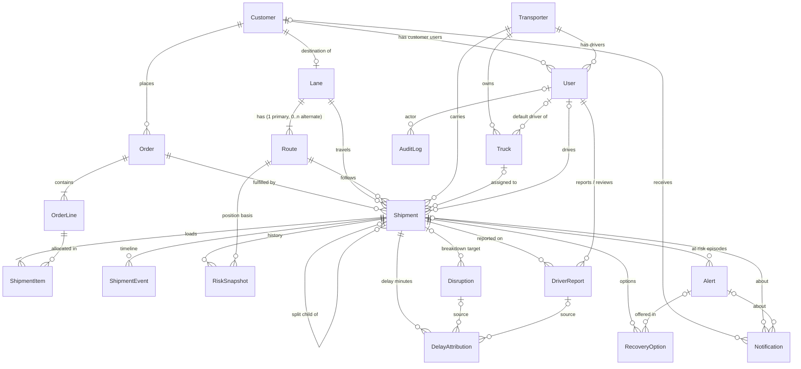

# 05 — Database schema: RoutePulse

Version 0.3, 2026-11-12. Status: **approved; revision 0.3 applies the locked decisions L1–L10** (architecture §0.1).
PostgreSQL (16 assumed) + Prisma. Companion to `04_TECH_ARCHITECTURE.md` (architecture) and `06_API_SPEC.md` (API).
The Prisma blocks below are a **design draft** for review. They are not yet a file in the repo.

**Source of truth [DECIDED D9, 2026-11-12]:** `apps/api/prisma/schema.prisma` is the single source of truth for models, fields, relations, enums and indexes. Constraints Prisma cannot express (CHECKs, partial unique indexes) are added as raw SQL in the same migration and listed next to each model below. No Zod or other schema library is used anywhere. Prisma Client generates the database TypeScript types; API DTOs are separate (see `06_API_SPEC.md`).

**Changes in 0.3:** `Shipment.physicalArrivalAt` (L6) and `Shipment.receivingWindowOverrideEndAt` (L4) added with CHECKs; arrival-based definitions of `arrivedAt`, `deliveredAt`, `delayMinutes`, `onTime` locked (L1); dashboard indexes moved from `deliveredAt` to `arrivedAt`; `EventType` gains `PHYSICAL_ARRIVAL` and `RECOVERY_APPLIED`; `NotificationKind.DELIVERED_LATE` renamed `ARRIVED_LATE`; AWAITING_CUSTOMER options are not superseded by routine recalculation; simplification S-1 rejected (L8).

**Changes in 0.2:** classification of all tables (§2.2); `Route.baselineMinutes`; `Lane.baselineMinutes` redefined; `Shipment.progressCarryMm`; arrival-based delay fields (pending architecture §19 issue 19); `RiskSnapshot.routeId`; `DelayAttribution` stores integer seconds and a `kind`; `SimState.lastStepAt` → `lastSettledAt`; enum `AttributionKind`; second seeded driver; Json columns validated by hand-written guards.

Labels: **[A]** assumption · **[VERIFY]** check against current Prisma docs at setup · **[RAW SQL]** not expressible in Prisma schema; added by hand to the migration (`prisma migrate dev --create-only`, then edit).

---

## 1. Conventions

| Topic | Rule |
|---|---|
| Primary keys | `id String @id @default(cuid())`. The seed sets fixed ids for seeded rows, so URLs and sessions survive a demo reset. |
| Human labels | Separate `code` column, unique (e.g. `SHP-1042`, `ORD-7781`, `TRK-07`). Shown in the UI; never used for access control. |
| Time | All timestamps `DateTime @db.Timestamptz(3)`, stored in UTC. **Simulation-time** columns have no default; the service sets them from `SimState.simTime`. Real-time bookkeeping uses `createdAt @default(now())`. |
| Durations | Integer minutes (`Int`), never floats. |
| Money | Integer INR (`Int`). |
| Weight | Tonnes, `Decimal @db.Decimal(6,1)`. |
| Distance | Kilometres, `Decimal @db.Decimal(7,2)`. |
| Coordinates | `Float` (double precision), WGS84. |
| Enums | Prisma enums (Postgres enum types). Same names exported from `packages/shared/enums.ts`. |
| Deletes | No user-facing deletes. Demo reset truncates mutable tables. FKs use `onDelete: Restrict` unless noted. |
| JSON columns | Used only for read-mostly structures: route geometry and segments, snapshot factors, recovery option params, notification params, event and audit data. Each has a TypeScript type and a **hand-written runtime guard** in `apps/api/src/guards/`, run on write (seed, services) and before serialisation (architecture §8.4). |

---

## 2. Entity list and why each table exists

| # | Table | Purpose | Spec / journey drivers |
|---|---|---|---|
| 1 | `User` | Login identity for all three roles | M1, spec §4 |
| 2 | `Customer` | Customer company, site location, receiving hours | M1 scope, M2 map, WIN factor |
| 3 | `Transporter` | Transport company (incl. small fleets) | M5, F1 |
| 4 | `Truck` | Vehicle, availability and location | Recovery: split / replacement (spec §5.6) |
| 5 | `Lane` | Plant → customer lane ("route" in the dashboard sense) | M5 by route, baseline transit |
| 6 | `Route` | Concrete path of a lane (primary / alternate), geometry, segments | M2 map, reroute, disruptions |
| 7 | `Order` | Customer order and its promised delivery time | M1 scope, M4 |
| 8 | `OrderLine` | Grade + quantity per order | Split shipment |
| 9 | `Shipment` | One truck movement for (part of) an order; live state, cached ETA/risk, delivery outcome | M2, M3, M4, M5 |
| 10 | `ShipmentItem` | Which order lines (and how much) are on a shipment | Split shipment |
| 11 | `ShipmentEvent` | Timeline: milestones and domain events | M2 milestones, X1 markers |
| 12 | `RiskSnapshot` | ETA/risk result with factor breakdown at a point in time | M3, X1, X2, impact KPIs |
| 13 | `Disruption` | Simulated or seeded event affecting segments, gate or a shipment | X4, DISR factor |
| 14 | `DriverReport` | Driver problem report and its two-step confirmation | F2, F3, RPT factor |
| 15 | `Alert` | An at-risk episode for a shipment, with the decision and customer response | M4 |
| 16 | `RecoveryOption` | Each option shown to the coordinator, per option set | M4, X3, audit of alternatives |
| 17 | `Notification` | In-app messages to coordinators and customers | M4 |
| 18 | `DelayAttribution` | Delay minutes by party and cause (live ledger → final) | F1, M5 causes, fair score |
| 19 | `AuditLog` | Who did what, when | Spec §5.14, Responsible AI |
| 20 | `SimState` | Single row: simulation clock and `worldVersion` | X4, freshness model |

### 2.1 Considered and rejected
| Rejected table | Why |
|---|---|
| `Delivery` | Delivery has no data beyond time and outcome (POD upload is out of scope, spec §3.2). Delivery fields live on `Shipment`: `arrivedAt`, `deliveredAt`, `delayMinutes`, `onTime`. |
| `Role`, `Permission` | Three fixed roles; an enum is enough. |
| `Session` | Signed JWT cookie; no server-side session store (architecture §7.1). |
| `RoadSegment`, `RouteLeg` | Segments are stored as a JSON array on `Route`, keyed by a shared `segmentCode` string. Disruptions target segment codes. Saves two tables and their joins. |
| `RecoveryAction` | The chosen option is a status on `RecoveryOption` plus `Alert.chosenOptionId`; the effect is recorded as a `ShipmentEvent` and an `AuditLog` row. |
| `Plant` | One fictional plant. Location, gates, bays and loading time are constants in `packages/shared/constants.ts` and API config. |
| `TransporterLaneStat` | HIST rates are computed from delivered `Shipment` + `DelayAttribution` rows and cached in memory; invalidated when a shipment is delivered. |
| `DriverPing` | Pings only update `Shipment.lastUpdateAt`. Storing them would add thousands of rows with no screen that needs them. |

### 2.2 Classification of the 20 tables
**Mandatory** = needed for M1–M5 or for P0 items in spec §3.1 (seed data, demo clock). **Differentiator** = needed only for X1–X4, F1–F3 or S1. **Optional** = supports a spec requirement outside M1–M5 (e.g. audit, spec §5.14) or could be replaced by a simpler structure.

| Table | Class | Needed for | If removed — consequence |
|---|---|---|---|
| `User` | Mandatory | M1 | No logins |
| `Customer` | Mandatory | M1 scope, M2 sites, WIN | No customer scope or sites |
| `Transporter` | Mandatory | M5 "by transporter" | No transporter dashboard |
| `Truck` | Mandatory | M4 feasible actions (split, replacement), truck labels | Recovery options could not check truck availability; M4 suggestions become unverifiable text |
| `Lane` | Mandatory | M5 "by route", baseline | Dashboard could not group by route |
| `Route` | Mandatory | M2 map geometry, movement | No map lines or simulated movement |
| `Order` | Mandatory | M1 customer scope, promise | Customer scope and promises would move onto shipments (possible, see simplification S-3) |
| `Shipment` | Mandatory | M2–M5 | Core entity |
| `ShipmentEvent` | Mandatory | M2 milestones with time and source (AC-M2.4) | Milestone history lost |
| `Alert` | Mandatory | M4 (episode, decision, customer response) | No dedup (AC-M4.7) or response record |
| `Notification` | Mandatory | M4 customer and coordinator alerts | No inbox |
| `RecoveryOption` | Mandatory | M4 suggested action; audit of alternatives (AC-M4.8) | Options recomputed on every read; cannot prove what was shown |
| `DelayAttribution` | Mandatory | M5 delay **causes**; also F1 | Dashboard causes would have no data source |
| `SimState` | Mandatory | P0 demo clock (spec §5.2); `worldVersion` | No clock, no freshness signal |
| `RiskSnapshot` | Differentiator | X1 replay; impact KPI history | Replay impossible; current ETA still on `Shipment` |
| `Disruption` | Differentiator | X4 simulator; seeded disruption in the fallback scope | No DISR factor; cut-order step 3 still needs one seeded disruption |
| `DriverReport` | Differentiator | F2, F3 | No driver reporting |
| `OrderLine` | Differentiator | SPLIT (X3/M4 split action) | Split would lose per-grade quantities |
| `ShipmentItem` | Differentiator | SPLIT | Same as above |
| `AuditLog` | Optional (spec §5.14, Responsible AI) | Decision history, logins, resets | Accountability story weakens; per-shipment history remains in `ShipmentEvent` |

### 2.3 Simplification candidates (not applied — team decision)
| ID | Simplification | Saves | Consequence | Recommendation |
|---|---|---|---|---|
| S-1 | Replace `OrderLine` + `ShipmentItem` with an `items Json` column on `Order` and `Shipment` (`[{gradeCode, quantityT, isUrgent}]`) | 2 tables | No FK integrity on quantities; split must check sums in code; dashboard unaffected | **Rejected (L8):** the relational schema is retained. |
| S-2 | Merge `AuditLog` into `ShipmentEvent` (nullable `shipmentId`) | 1 table | Mixes domain timeline and security log; non-shipment audit (logins, resets) needs nullable FK; customer timeline filter becomes stricter | Keep separate. |
| S-3 | Merge `Order` into `Shipment` | 1 table | Split children would duplicate order data; customer "orders" view disappears | Keep. |
| S-4 | Drop `RiskSnapshot` and store only `firstAtRiskAt` | 1 table | Removes X1 replay (cut-order step 2 in spec §3.3) | Only if X1 is cut. |
| S-5 | Drop `Notification`; derive inbox from `Alert` | 1 table | Loses PLAN_UPDATED, DELIVERED, REPORT_NEEDS_REVIEW messages and read state | Keep. |

No table is removed in this revision.

---

## 3. ER diagram



`SimState` is a stand-alone single-row table.

---

## 4. Enums

```prisma
enum Role            { COORDINATOR CUSTOMER DRIVER }
enum Milestone       { ORDER_CONFIRMED TRUCK_ASSIGNED AT_GATE LOADING GATE_OUT IN_TRANSIT ARRIVED DELIVERED }
enum RiskLevel       { ON_TRACK WATCH AT_RISK LATE }
enum Confidence      { HIGH MEDIUM LOW }
enum Party           { PLANT TRANSPORTER CUSTOMER EXTERNAL UNATTRIBUTED }
enum FactorCode      { GATE HIST DISR RPT WIN }
enum ReasonCode {
  BREAKDOWN PLANT_GATE_WAIT TRAFFIC ROAD_CLOSED HEAVY_RAIN DOCUMENTS UNLOADING_WAIT OTHER   // driver chips (spec §5.8)
  TRANSPORTER_PACE RECEIVING_WINDOW                                                         // system causes (HIST, WIN)
}
enum EventType {
  MILESTONE DRIVER_REPORT REPORT_REVIEWED DISRUPTION_STARTED DISRUPTION_ENDED
  ALERT_OPENED ALERT_RESOLVED CUSTOMER_NOTIFIED CUSTOMER_RESPONDED
  RECOVERY_CHOSEN RECOVERY_APPLIED ATTRIBUTION_OVERRIDDEN PHYSICAL_ARRIVAL
}
enum EventSource     { DRIVER COORDINATOR SIMULATION SEED SYSTEM }
enum DisruptionKind  { WEATHER_SLOWDOWN ROAD_CLOSURE GATE_CONGESTION TRUCK_BREAKDOWN }
enum DisruptionOrigin{ SEED SIMULATOR }
enum ReportStatus    { PENDING_REVIEW CONFIRMED }
enum AlertStatus     { OPEN ACTION_CHOSEN RESOLVED }
enum CustomerResponse{ ACCEPT_PROPOSAL PREFER_TO_WAIT REQUEST_CALL }
enum RecoveryKind    { REROUTE SPLIT REPLACEMENT_TRUCK NEW_WINDOW NOTIFY_ONLY }
enum OptionStatus    { PROPOSED AWAITING_CUSTOMER CHOSEN SUPERSEDED }
enum Audience        { COORDINATOR CUSTOMER }
enum NotificationKind {
  AT_RISK AT_RISK_CUSTOMER RECOVERY_CONFIRMED PLAN_UPDATED REPORT_NEEDS_REVIEW
  CUSTOMER_RESPONDED BACK_ON_TRACK DELIVERED ARRIVED_LATE
}
enum TruckStatus     { AVAILABLE ASSIGNED MAINTENANCE }
enum AttributionStatus { LIVE FINAL }
enum AttributionKind { TIME_LOST PLAN_CHANGE GAP }   // ledger time / reroute baseline difference / unexplained remainder
enum SnapshotTrigger { STEP MILESTONE REPORT REVIEW DISRUPTION RECOVERY SEED }
```

Default reason → party mapping (spec §5.8) lives in API config, not in the database.

The API validates incoming enum values against Prisma Client's generated enum objects (`Object.values(ReasonCode)`), and `packages/shared/src/enums.ts` mirrors these enums for the browser with a compile-time drift check (architecture §8.3).

---

## 5. Entities

### 5.1 `User`
```prisma
model User {
  id            String   @id @default(cuid())
  email         String   @unique            // stored lower-case
  passwordHash  String
  name          String
  phone         String?                      // fictional; never sent to customers
  role          Role
  customerId    String?
  transporterId String?
  isActive      Boolean  @default(true)
  createdAt     DateTime @default(now()) @db.Timestamptz(3)

  customer      Customer?    @relation(fields: [customerId], references: [id])
  transporter   Transporter? @relation(fields: [transporterId], references: [id])
  drivenShipments  Shipment[]     @relation("ShipmentDriver")
  defaultTrucks    Truck[]        @relation("TruckDefaultDriver")
  reports          DriverReport[] @relation("ReportReporter")
  reviews          DriverReport[] @relation("ReportReviewer")
  auditEntries     AuditLog[]
}
```
- **PK** `id`. **FK** `customerId → Customer.id`, `transporterId → Transporter.id`.
- **Constraints [RAW SQL]:** `CHECK ((role='CUSTOMER' AND "customerId" IS NOT NULL AND "transporterId" IS NULL) OR (role='DRIVER' AND "transporterId" IS NOT NULL AND "customerId" IS NULL) OR (role='COORDINATOR' AND "customerId" IS NULL AND "transporterId" IS NULL))`. `CHECK (email = lower(email))`.
- **Indexes:** unique `email`; `@@index([customerId])`, `@@index([transporterId])`.

### 5.2 `Customer`
```prisma
model Customer {
  id                 String @id @default(cuid())
  code               String @unique              // e.g. CUST-KES
  name               String                      // fictional, e.g. "Kestrel Moulders"
  city               String
  lat                Float
  lng                Float
  receivingOpenMin   Int                         // minutes after local midnight, e.g. 480 = 08:00
  receivingCloseMin  Int                         // e.g. 1080 = 18:00
  unloadingMinutes   Int    @default(60)
  timezone           String @default("Asia/Kolkata")

  users         User[]
  lane          Lane?
  orders        Order[]
  notifications Notification[]
}
```
- **Constraints [RAW SQL]:** `CHECK ("receivingOpenMin" BETWEEN 0 AND 1439 AND "receivingCloseMin" BETWEEN 1 AND 1440 AND "receivingOpenMin" < "receivingCloseMin")`; `CHECK ("unloadingMinutes" > 0)`.
- **Indexes:** unique `code`.

### 5.3 `Transporter`
```prisma
model Transporter {
  id         String @id @default(cuid())
  code       String @unique                // e.g. TR-GHAT
  name       String                        // fictional, e.g. "Ghatline Carriers"
  fleetSize  Int

  users      User[]
  trucks     Truck[]
  shipments  Shipment[]
}
```
- "Small transporter" = `fleetSize ≤ 10` **[A]**, derived in analytics (no column).
- **Constraints [RAW SQL]:** `CHECK ("fleetSize" > 0)`.

### 5.4 `Truck`
```prisma
model Truck {
  id                  String      @id @default(cuid())
  code                String      @unique   // fictional registration-style label, e.g. TRK-07
  transporterId       String
  capacityT           Decimal     @db.Decimal(6,1)
  status              TruckStatus @default(AVAILABLE)
  locationLabel       String                // e.g. "Plant X, Bay 2", "Khopoli yard"
  lat                 Float
  lng                 Float
  defaultDriverUserId String?

  transporter   Transporter @relation(fields: [transporterId], references: [id])
  defaultDriver User?       @relation("TruckDefaultDriver", fields: [defaultDriverUserId], references: [id])
  shipments     Shipment[]

  @@index([status, transporterId])
}
```
- **FK** `transporterId → Transporter.id`; `defaultDriverUserId → User.id` (must be a DRIVER of the same transporter — checked in the seed and service; cross-table CHECK is not used).
- **Constraints [RAW SQL]:** `CHECK ("capacityT" > 0)`.

### 5.5 `Lane`
```prisma
model Lane {
  id               String  @id @default(cuid())
  code             String  @unique         // e.g. LN-PUNE
  name             String                  // "Plant X → Pune"
  customerId       String  @unique         // one lane per customer site [A]
  baselineMinutes  Int                     // = primary Route.baselineMinutes (copied at seed; seed check enforces equality)
  distanceKm       Decimal @db.Decimal(7,2)

  customer   Customer   @relation(fields: [customerId], references: [id])
  routes     Route[]
  shipments  Shipment[]
}
```
- One lane per customer (each fictional customer has one site) **[A]**. The dashboard's "by route" groups by `Lane` (spec §5.10).
- `baselineMinutes` is the baseline of the primary route (Σ segment length ÷ speed), not a historical median. Seeded history is generated *around* this baseline. This is required for the ETA identity (architecture §10.1).
- **Constraints [RAW SQL]:** `CHECK ("baselineMinutes" > 0 AND "distanceKm" > 0)`.

### 5.6 `Route`
```prisma
model Route {
  id         String  @id @default(cuid())
  code       String  @unique               // e.g. RT-PUNE-A (primary), RT-PUNE-B (alternate)
  laneId     String
  name       String                        // "Expressway via ghat"
  isPrimary  Boolean
  lengthKm   Decimal @db.Decimal(7,2)
  baselineMinutes Int                      // Σ segment minutes, each rounded once at seed (architecture §10.1)
  geometry   Json                          // GeoJSON LineString
  segments   Json                          // Segment[]: { segmentCode, name, startKm, endKm, speedKmh }

  lane       Lane           @relation(fields: [laneId], references: [id])
  shipments  Shipment[]
  snapshots  RiskSnapshot[]

  @@index([laneId])
}
```
- `segments` is checked by the hand-written guard `isSegmentArray` plus a seed check: ordered, contiguous (`startKm` of n+1 = `endKm` of n), last `endKm = lengthKm`, `speedKmh > 0`, and Σ rounded segment minutes = `baselineMinutes`. A `segmentCode` used on two routes means "the same stretch of road" — that is how one weather event affects several lanes.
- **Constraints [RAW SQL]:** partial unique index — one primary route per lane: `CREATE UNIQUE INDEX route_one_primary_per_lane ON "Route"("laneId") WHERE "isPrimary";`

### 5.7 `Order`
```prisma
model Order {
  id          String   @id @default(cuid())
  code        String   @unique             // ORD-7781
  customerId  String
  promisedBy  DateTime @db.Timestamptz(3)  // promise to the customer (sim time)
  placedAt    DateTime @db.Timestamptz(3)  // sim time

  customer   Customer    @relation(fields: [customerId], references: [id])
  lines      OrderLine[]
  shipments  Shipment[]

  @@index([customerId, promisedBy])
}
```
- Order status is derived from its shipments (all delivered → delivered). No status column, so it cannot disagree with shipments.

### 5.8 `OrderLine`
```prisma
model OrderLine {
  id         String  @id @default(cuid())
  orderId    String
  gradeCode  String                        // fictional, e.g. "PX-PP 110"
  quantityT  Decimal @db.Decimal(6,1)
  isUrgent   Boolean @default(false)       // which part a SPLIT sends first

  order  Order          @relation(fields: [orderId], references: [id], onDelete: Cascade)
  items  ShipmentItem[]

  @@unique([orderId, gradeCode])
}
```
- **Constraints [RAW SQL]:** `CHECK ("quantityT" > 0)`.

### 5.9 `Shipment`
```prisma
model Shipment {
  id                 String    @id @default(cuid())
  code               String    @unique     // SHP-1042
  orderId            String
  laneId             String
  routeId            String
  transporterId      String
  truckId            String?
  driverUserId       String?
  parentShipmentId   String?               // set on a SPLIT child
  autopilot          Boolean   @default(true)   // false = milestones recorded by a person (hero)
  isHistorical       Boolean   @default(false)  // seeded delivered history

  // Plan and promise (sim time)
  currentMilestone   Milestone
  plannedGateAt      DateTime  @db.Timestamptz(3)
  plannedDepartureAt DateTime  @db.Timestamptz(3)
  plannedArrivalAt   DateTime  @db.Timestamptz(3)  // plannedDeparture + primary route baseline (arrival at customer)
  promisedBy         DateTime  @db.Timestamptz(3)  // agreed promise (copied from Order; may be renegotiated)
  originalPromisedBy DateTime  @db.Timestamptz(3)  // never changed after planning (L4)
  renegotiated       Boolean   @default(false)
  receivingWindowOverrideEndAt DateTime? @db.Timestamptz(3)  // L4: accepted NEW_WINDOW end for this shipment only; Customer hours untouched

  // Live movement state (written only by simulation steps and actions)
  progressM          Int       @default(0)                   // distance along current route, integer metres (API shows km)
  progressCarryMm    Int       @default(0)                   // sub-metre carry so split settles are exact (architecture §9.2)
  stoppedUntil       DateTime? @db.Timestamptz(3)
  gateQueuedAt       DateTime? @db.Timestamptz(3)
  loadingStartedAt   DateTime? @db.Timestamptz(3)
  gateOutAt          DateTime? @db.Timestamptz(3)
  lastUpdateAt       DateTime? @db.Timestamptz(3)  // last ping or driver action
  pingIntervalMinutes Int      @default(30)
  silentFrom         DateTime? @db.Timestamptz(3)  // seeded "no signal" period for Low confidence

  // Cached result of the latest recalculation (source of truth for lists and the map)
  etaAt              DateTime? @db.Timestamptz(3)
  etaLowAt           DateTime? @db.Timestamptz(3)
  etaHighAt          DateTime? @db.Timestamptz(3)
  slackMinutes       Int?
  riskLevel          RiskLevel?
  riskScore          Int?
  confidence         Confidence?
  currentOptionSetId String?                       // latest recovery option set (staleness check)

  // Impact indicators (spec §7)
  firstAtRiskAt      DateTime? @db.Timestamptz(3)
  customerNotifiedAt DateTime? @db.Timestamptz(3)

  // Arrival and delivery outcome (replaces a Delivery table) — L1, L6
  physicalArrivalAt  DateTime? @db.Timestamptz(3)  // truck reached the customer gate (set by the simulation)
  arrivedAt          DateTime? @db.Timestamptz(3)  // arrival at the receiving gate = eligible check-in time of physicalArrivalAt; set when ARRIVED is recorded, never the tap time
  deliveredAt        DateTime? @db.Timestamptz(3)  // unloading complete = arrivedAt + unloadingMinutes (+ confirmed unloading waits)
  delayMinutes       Int?                          // max(0, arrivedAt − promisedBy), set at ARRIVED
  onTime             Boolean?                      // arrivedAt ≤ promisedBy (agreed promise, D4/L1)

  createdAt          DateTime  @default(now()) @db.Timestamptz(3)
  updatedAt          DateTime  @updatedAt @db.Timestamptz(3)

  order        Order        @relation(fields: [orderId], references: [id])
  lane         Lane         @relation(fields: [laneId], references: [id])
  route        Route        @relation(fields: [routeId], references: [id])
  transporter  Transporter  @relation(fields: [transporterId], references: [id])
  truck        Truck?       @relation(fields: [truckId], references: [id])
  driver       User?        @relation("ShipmentDriver", fields: [driverUserId], references: [id])
  parent       Shipment?    @relation("ShipmentSplit", fields: [parentShipmentId], references: [id])
  children     Shipment[]   @relation("ShipmentSplit")
  items        ShipmentItem[]
  events       ShipmentEvent[]
  snapshots    RiskSnapshot[]
  disruptions  Disruption[]
  reports      DriverReport[]
  alerts       Alert[]
  options      RecoveryOption[]
  attributions DelayAttribution[]
  notifications Notification[]

  @@index([isHistorical, riskScore(sort: Desc)])     // coordinator list sorted by risk
  @@index([driverUserId, currentMilestone])          // driver trip
  @@index([orderId])                                 // customer scope via order
  @@index([laneId, arrivedAt])                       // dashboard by lane + period (arrival-based, L1)
  @@index([transporterId, arrivedAt])                // dashboard by transporter + period
}
```
- **FK** `orderId`, `laneId`, `routeId`, `transporterId`, `truckId?`, `driverUserId?`, `parentShipmentId?` (self).
- **Consistency rules (service-enforced, seed-checked):** `route.laneId = laneId`; `lane.customerId = order.customerId`; `driver.transporterId = transporterId`; `truck.transporterId = transporterId`.
- **Constraints [RAW SQL]:**
  - `CHECK ("progressM" >= 0 AND "progressCarryMm" BETWEEN 0 AND 999)`
  - `CHECK ("riskScore" IS NULL OR "riskScore" BETWEEN 0 AND 100)`
  - `CHECK (("arrivedAt" IS NULL) = ("delayMinutes" IS NULL) AND ("arrivedAt" IS NULL) = ("onTime" IS NULL))`
  - `CHECK ("deliveredAt" IS NULL OR "arrivedAt" IS NOT NULL)`
  - `CHECK ("arrivedAt" IS NULL OR ("physicalArrivalAt" IS NOT NULL AND "arrivedAt" >= "physicalArrivalAt"))` (L6)
  - `CHECK ("receivingWindowOverrideEndAt" IS NULL OR ("renegotiated" AND "receivingWindowOverrideEndAt" > "originalPromisedBy"))` (L4)
  - `CHECK ("delayMinutes" IS NULL OR "delayMinutes" >= 0)`
  - `CHECK ("deliveredAt" IS NULL OR "arrivedAt" IS NULL OR "deliveredAt" >= "arrivedAt")`
  - `CHECK ("plannedArrivalAt" > "plannedDepartureAt")`
  - Partial unique — a truck carries at most one live shipment: `CREATE UNIQUE INDEX shipment_one_live_per_truck ON "Shipment"("truckId") WHERE "truckId" IS NOT NULL AND "currentMilestone" <> 'DELIVERED' AND NOT "isHistorical";`
- **Why cached ETA fields here and in `RiskSnapshot`:** lists, map and alerts read one row per shipment (fast); snapshots keep history for replay. The recalculation pipeline writes both in one transaction (architecture §6.3).

### 5.10 `ShipmentItem`
```prisma
model ShipmentItem {
  id          String  @id @default(cuid())
  shipmentId  String
  orderLineId String
  quantityT   Decimal @db.Decimal(6,1)

  shipment   Shipment  @relation(fields: [shipmentId], references: [id], onDelete: Cascade)
  orderLine  OrderLine @relation(fields: [orderLineId], references: [id])

  @@unique([shipmentId, orderLineId])
}
```
- **Constraints [RAW SQL]:** `CHECK ("quantityT" > 0)`. Sum of items per order line ≤ line quantity — service-enforced when splitting.

### 5.11 `ShipmentEvent`
```prisma
model ShipmentEvent {
  id          String      @id @default(cuid())
  shipmentId  String
  type        EventType
  milestone   Milestone?               // set when type = MILESTONE
  simTime     DateTime    @db.Timestamptz(3)
  source      EventSource
  actorUserId String?
  data        Json        @default("{}")   // typed per EventType in packages/shared
  createdAt   DateTime    @default(now()) @db.Timestamptz(3)

  shipment Shipment @relation(fields: [shipmentId], references: [id], onDelete: Cascade)

  @@index([shipmentId, simTime])
}
```
- **Constraints [RAW SQL]:** `CHECK ((type = 'MILESTONE') = (milestone IS NOT NULL))`; partial unique — each milestone at most once per shipment: `CREATE UNIQUE INDEX event_milestone_once ON "ShipmentEvent"("shipmentId", milestone) WHERE type = 'MILESTONE';`
- Serves: milestone list with time and source (AC-M2.4), replay markers (AC-X1.1), customer-safe timeline (serializer filters event types).

### 5.12 `RiskSnapshot`
```prisma
model RiskSnapshot {
  id                 String          @id @default(cuid())
  shipmentId         String
  routeId            String                         // route at snapshot time (changes after a reroute)
  simTime            DateTime        @db.Timestamptz(3)
  trigger            SnapshotTrigger
  ruleVersion        String                         // "eta-rules-v1"
  plannedArrivalAt   DateTime        @db.Timestamptz(3)
  predictedArrivalAt DateTime        @db.Timestamptz(3)
  etaLowAt           DateTime        @db.Timestamptz(3)
  etaHighAt          DateTime        @db.Timestamptz(3)
  slackMinutes       Int
  level              RiskLevel
  score              Int
  confidence         Confidence
  progressKm         Decimal         @db.Decimal(7,2)  // with routeId, gives the replay map position
  factors            Json                           // Factor[] (see 06_API_SPEC.md §2), phases INCURRED / PLAN_CHANGE / EXPECTED

  shipment Shipment @relation(fields: [shipmentId], references: [id], onDelete: Cascade)
  route    Route    @relation(fields: [routeId], references: [id])

  @@index([shipmentId, simTime])
}
```
- **Constraints [RAW SQL]:** `CHECK (score BETWEEN 0 AND 100)`; `CHECK ("etaLowAt" <= "predictedArrivalAt" AND "predictedArrivalAt" <= "etaHighAt")`.
- Invariant (tested in the engine, not the DB): `plannedArrivalAt + Σ factors[].minutes = predictedArrivalAt` (AC-M3.2), where factors cover incurred (I), plan-change (P) and expected (E) minutes (architecture §10.2).
- `Route` gains the back-relation `snapshots RiskSnapshot[]`.
- Volume: ~12 live shipments × ~30 snapshots/day ≈ 400 rows per demo day. Small.

### 5.13 `Disruption`
```prisma
model Disruption {
  id                   String           @id @default(cuid())
  kind                 DisruptionKind
  origin               DisruptionOrigin
  label                String                       // "Heavy rain on ghat section"
  segmentCodes         String[]                     // WEATHER_SLOWDOWN, ROAD_CLOSURE
  shipmentId           String?                      // TRUCK_BREAKDOWN
  slowdownPct          Int?                         // WEATHER_SLOWDOWN
  extraMinutesPerTruck Int?                         // GATE_CONGESTION
  stopMinutes          Int?                         // ROAD_CLOSURE duration, TRUCK_BREAKDOWN repair
  party                Party
  reasonCode           ReasonCode
  startsAt             DateTime         @db.Timestamptz(3)
  endsAt               DateTime         @db.Timestamptz(3)
  endedEarlyAt         DateTime?        @db.Timestamptz(3)
  createdByUserId      String?
  createdAt            DateTime         @default(now()) @db.Timestamptz(3)

  shipment     Shipment?          @relation(fields: [shipmentId], references: [id])
  attributions DelayAttribution[]

  @@index([startsAt, endsAt])
}
```
- **Constraints [RAW SQL]:**
  - `CHECK ("endsAt" > "startsAt")`
  - `CHECK (kind <> 'WEATHER_SLOWDOWN' OR ("slowdownPct" BETWEEN 1 AND 90 AND cardinality("segmentCodes") > 0))`
  - `CHECK (kind <> 'ROAD_CLOSURE' OR cardinality("segmentCodes") > 0)`
  - `CHECK (kind <> 'GATE_CONGESTION' OR "extraMinutesPerTruck" > 0)`
  - `CHECK (kind <> 'TRUCK_BREAKDOWN' OR ("shipmentId" IS NOT NULL AND "stopMinutes" > 0))`
- Active = `startsAt ≤ simTime < coalesce(endedEarlyAt, endsAt)`. A GIN index on `segmentCodes` is not needed at this size.

### 5.14 `DriverReport`
```prisma
model DriverReport {
  id                String       @id @default(cuid())
  shipmentId        String
  reporterUserId    String
  simTime           DateTime     @db.Timestamptz(3)
  chipReason        ReasonCode?                // chip tapped, if any
  text              String?                    // typed note, ≤ 280 chars
  suggestedReason   ReasonCode?                // keyword classifier output
  matchedKeywords   String[]                   // shown to the driver (AC-F2.2)
  reason            ReasonCode                 // driver-confirmed reason
  estimatedMinutes  Int?                       // driver's "how long?" choice
  appliedMinutes    Int                        // estimate, or reason default
  party             Party                      // default from reason; coordinator may change
  status            ReportStatus @default(PENDING_REVIEW)
  reviewedByUserId  String?
  reviewedAt        DateTime?    @db.Timestamptz(3)
  reviewNote        String?                    // required if reason or party changed
  originalReason    ReasonCode?                // kept when coordinator changes it
  originalParty     Party?
  createdAt         DateTime     @default(now()) @db.Timestamptz(3)

  shipment     Shipment           @relation(fields: [shipmentId], references: [id])
  reporter     User               @relation("ReportReporter", fields: [reporterUserId], references: [id])
  reviewer     User?              @relation("ReportReviewer", fields: [reviewedByUserId], references: [id])
  attributions DelayAttribution[]

  @@index([status, simTime])
  @@index([shipmentId, simTime])
}
```
- **Constraints [RAW SQL]:** `CHECK ("chipReason" IS NOT NULL OR "text" IS NOT NULL)`; `CHECK (char_length(coalesce(text,'')) <= 280)`; `CHECK ("appliedMinutes" > 0)`; `CHECK (status = 'PENDING_REVIEW' OR ("reviewedByUserId" IS NOT NULL AND "reviewedAt" IS NOT NULL))`; `CHECK (("originalReason" IS NULL AND "originalParty" IS NULL) OR "reviewNote" IS NOT NULL)`.
- A report exists only after the driver confirms the reason (AC-F2.2); the classifier preview is stateless and writes nothing.

### 5.15 `Alert`
```prisma
model Alert {
  id                        String            @id @default(cuid())
  shipmentId                String
  status                    AlertStatus       @default(OPEN)
  openedAt                  DateTime          @db.Timestamptz(3)
  resolvedAt                DateTime?         @db.Timestamptz(3)
  topFactor                 FactorCode?
  topReason                 ReasonCode?
  proposedOptionId          String?           // Suggested option at opening (shown to customer)
  chosenOptionId            String?
  chosenByUserId            String?
  chosenAt                  DateTime?         @db.Timestamptz(3)
  customerResponse          CustomerResponse?
  customerRespondedAt       DateTime?         @db.Timestamptz(3)
  customerRespondedByUserId String?

  shipment      Shipment         @relation(fields: [shipmentId], references: [id])
  options       RecoveryOption[]
  notifications Notification[]

  @@index([status, openedAt])
  @@index([shipmentId])
}
```
- `proposedOptionId` / `chosenOptionId` are plain string ids (not Prisma relations) to avoid a circular relation with `RecoveryOption`; the service validates them. **[A]**
- **Constraints [RAW SQL]:** one open episode per shipment (AC-M4.7): `CREATE UNIQUE INDEX alert_one_open_per_shipment ON "Alert"("shipmentId") WHERE status IN ('OPEN','ACTION_CHOSEN');` · `CHECK (status <> 'ACTION_CHOSEN' OR ("chosenOptionId" IS NOT NULL AND "chosenByUserId" IS NOT NULL))` · `CHECK (("customerResponse" IS NULL) = ("customerRespondedAt" IS NULL))`.

### 5.16 `RecoveryOption`
```prisma
model RecoveryOption {
  id                  String       @id @default(cuid())
  shipmentId          String
  alertId             String?
  optionSetId         String                     // groups options shown together
  createdAtSim        DateTime     @db.Timestamptz(3)
  kind                RecoveryKind
  feasible            Boolean
  infeasibleReason    String?
  newEtaAt            DateTime?    @db.Timestamptz(3)
  etaLowAt            DateTime?    @db.Timestamptz(3)
  etaHighAt           DateTime?    @db.Timestamptz(3)
  meetsPromise        Boolean
  minutesSavedVsNotify Int
  extraCostInr        Int
  co2eDeltaKg         Decimal?     @db.Decimal(8,1)  // null until G-CO2 passes (AC-S1.1)
  co2eMethod          String?                       // formula + factor source when not null
  isSuggested         Boolean      @default(false)
  suggestionRule      String                        // human-readable rule text (AC-M4.4)
  constraints         String[]                      // "needs TRK-11, free at Khopoli from 11:30"
  params              Json                          // typed per kind: { truckId?, routeId?, items?, newWindowEnd? }
  status              OptionStatus @default(PROPOSED)

  shipment Shipment @relation(fields: [shipmentId], references: [id])
  alert    Alert?   @relation(fields: [alertId], references: [id])

  @@index([shipmentId, optionSetId])
  @@unique([optionSetId, kind])
}
```
- **Constraints [RAW SQL]:** at most one Suggested per set: `CREATE UNIQUE INDEX option_one_suggested_per_set ON "RecoveryOption"("optionSetId") WHERE "isSuggested";` · `CHECK (feasible OR "infeasibleReason" IS NOT NULL)` · `CHECK (NOT "isSuggested" OR (feasible AND kind NOT IN ('NEW_WINDOW','NOTIFY_ONLY')))` · `CHECK ("extraCostInr" >= 0)` · `CHECK (("co2eDeltaKg" IS NULL) = ("co2eMethod" IS NULL))`.
- Older sets are marked `SUPERSEDED` when a new set is generated, **except** an option in `AWAITING_CUSTOMER` (a chosen NEW_WINDOW): it is superseded only when the coordinator chooses another option or the alert resolves (L4). `Shipment.currentOptionSetId` points at the latest set.
- For NEW_WINDOW, `params.newWindowEnd` is fixed at generation and is the only value applied on acceptance (preview = execution, L4).

### 5.17 `Notification`
```prisma
model Notification {
  id          String           @id @default(cuid())
  audience    Audience
  customerId  String?                          // required when audience = CUSTOMER
  shipmentId  String?
  alertId     String?
  kind        NotificationKind
  templateKey String                           // e.g. "notif.atRisk.customer"
  params      Json                             // values for the template
  text        String                           // English fallback, rendered on the server
  simTime     DateTime         @db.Timestamptz(3)
  readAt      DateTime?        @db.Timestamptz(3)
  createdAt   DateTime         @default(now()) @db.Timestamptz(3)

  customer Customer? @relation(fields: [customerId], references: [id])
  shipment Shipment? @relation(fields: [shipmentId], references: [id])
  alert    Alert?    @relation(fields: [alertId], references: [id])

  @@index([audience, customerId, readAt])
  @@index([shipmentId])
}
```
- **Constraints [RAW SQL]:** `CHECK ((audience = 'CUSTOMER') = ("customerId" IS NOT NULL))`.
- Coordinator notifications are shared by all coordinators (one read state) — accepted for the prototype (architecture §17, issue 11).
- Customer `params` never contain driver identity (AC-M1.6); enforced by the template builder and a unit test.

### 5.18 `DelayAttribution`
```prisma
model DelayAttribution {
  id               String            @id @default(cuid())
  shipmentId       String
  sourceKey        String            // "GATE" | "HIST" | "DISR:<disruptionId>" | "RPT:<reportId>" | "WIN" | "ROUTE:<disruptionId>" | "GAP"
  kind             AttributionKind   @default(TIME_LOST)
  factor           FactorCode?       // null for the GAP row
  reason           ReasonCode?
  party            Party
  delaySeconds     Int               // integer seconds; API converts to minutes with largest-remainder rounding
  status           AttributionStatus @default(LIVE)
  disruptionId     String?
  driverReportId   String?
  originalParty    Party?            // set on override
  overrideNote     String?
  overriddenByUserId String?
  overriddenAt     DateTime?         @db.Timestamptz(3)
  updatedAtSim     DateTime          @db.Timestamptz(3)

  shipment     Shipment      @relation(fields: [shipmentId], references: [id], onDelete: Cascade)
  disruption   Disruption?   @relation(fields: [disruptionId], references: [id])
  driverReport DriverReport? @relation(fields: [driverReportId], references: [id])

  @@unique([shipmentId, sourceKey, party])          // upsert target for the live ledger
  @@index([party, status])
  @@index([shipmentId])
}
```
- Holds **incurred** time (`kind = TIME_LOST`) and **plan-change** time from a reroute (`kind = PLAN_CHANGE`, `sourceKey = "ROUTE:<disruptionId>"`, party of the avoided disruption). Expected time lives only in `RiskSnapshot.factors`. This split is what prevents double counting (architecture §10.2).
- The settle operation upserts on `(shipmentId, sourceKey, party)` and adds seconds. WIN knock-on writes one row per receiving party (architecture §10.3–10.5).
- At ARRIVED: rows become `FINAL` (nothing after arrival affects the promise, L1/L6); a `kind = GAP` row with party `UNATTRIBUTED` stores any difference between `Shipment.delayMinutes` and the attributed minutes (AC-F1.1).
- Override: the whole row moves to a new party; `originalParty`, note, user and time are stored; an `AuditLog` row is written (AC-F1.3). If a row with the target party already exists, the service merges the seconds into it.
- **Constraints [RAW SQL]:** `CHECK ("delaySeconds" >= 0)`; `CHECK (("originalParty" IS NULL) = ("overrideNote" IS NULL))`; `CHECK ("sourceKey" NOT LIKE 'DISR:%' OR "disruptionId" IS NOT NULL)`; `CHECK ("sourceKey" NOT LIKE 'ROUTE:%' OR ("disruptionId" IS NOT NULL AND kind = 'PLAN_CHANGE'))`; `CHECK ("sourceKey" NOT LIKE 'RPT:%' OR "driverReportId" IS NOT NULL)`; `CHECK ((kind = 'GAP') = ("sourceKey" = 'GAP'))`; `CHECK (kind <> 'GAP' OR party = 'UNATTRIBUTED')`.

### 5.19 `AuditLog`
```prisma
model AuditLog {
  id          String   @id @default(cuid())
  actorUserId String?                      // null for SYSTEM / SIMULATION
  actorRole   Role?
  action      String                       // e.g. "auth.login", "recovery.choose", "attribution.override", "sim.reset"
  entityType  String                       // "Shipment", "Alert", "DriverReport", ...
  entityId    String?
  simTime     DateTime? @db.Timestamptz(3)
  data        Json     @default("{}")      // e.g. chosen option + ids of alternatives shown
  createdAt   DateTime @default(now()) @db.Timestamptz(3)

  actor User? @relation(fields: [actorUserId], references: [id])

  @@index([entityType, entityId, createdAt])
  @@index([createdAt])
}
```
- `action` is a string (not an enum) so new audit actions need no migration; allowed values are listed in `packages/shared`.
- **Survives demo reset?** No — reset clears it, except a single `sim.reset` row written after the reseed. **[A]** (A permanent audit across resets would need a separate table; not worth it for the demo.)

### 5.20 `SimState`
```prisma
model SimState {
  id           Int      @id @default(1)
  simTime      DateTime @db.Timestamptz(3)
  running      Boolean  @default(false)
  speed        Int      @default(1)        // 1, 10 or 60
  stepMinutes  Int      @default(5)
  lastSettledAt DateTime @db.Timestamptz(3) // movement + ledger computed up to here (architecture §9.1)
  worldVersion Int      @default(0)        // monotonic, also across resets
  seedName     String                      // e.g. "hero-v1"
  simError     String?
}
```
- **Constraints [RAW SQL]:** `CHECK (id = 1)`; `CHECK (speed IN (1,10,60))`; `CHECK ("stepMinutes" > 0)`; `CHECK ("lastSettledAt" <= "simTime")`.

---

## 6. Migration notes [RAW SQL] and [VERIFY]

1. Generate the migration with `prisma migrate dev --create-only`, then append all **[RAW SQL]** statements above (CHECK constraints and partial unique indexes) to the generated SQL file, then apply. **[VERIFY]** whether the current Prisma version supports partial indexes natively; if yes, prefer the native form.
2. `Decimal` maps to `Prisma.Decimal` in the client. Serializers convert to `number` with one or two decimals before sending JSON.
2a. No schema-validation library is used (D9). Json columns are checked by hand-written guards (§1); enum inputs are checked against Prisma Client's enum objects; everything else is validated by hand in controllers and services (architecture §8.2).
3. Reset order (truncate): `Notification, RecoveryOption, Alert, DelayAttribution, DriverReport, Disruption, RiskSnapshot, ShipmentEvent, ShipmentItem, Shipment, OrderLine, Order, Truck, Route, Lane, User, Transporter, Customer, AuditLog` with `TRUNCATE … RESTART IDENTITY CASCADE`, then seed. `SimState` is updated, not truncated, to keep `worldVersion` monotonic.

---

## 7. Seed data volumes [A]

| Table | Rows (approx.) |
|---|---|
| Customer | 6 |
| Lane | 6 |
| Route | 9 (6 primary + 3 alternate) |
| Transporter | 5 |
| Truck | 20 |
| User | 1 coordinator + 6 customer users + 8 drivers (incl. the hero driver and a second driver of the same transporter for the replacement truck, D3) |
| Order / OrderLine | ~210 / ~350 |
| Shipment | ~200 historical + ~12 live |
| ShipmentEvent | ~1,800 |
| DelayAttribution | ~400 |
| RiskSnapshot | ~150 (live start state + a few historical replays) |
| Alert / Notification | ~40 / ~90 (history) |

Reset inserts ≈ 3,500 rows with `createMany` in one transaction — well inside the 5 s target (AC-X4.3).

---

## 8. Requirement coverage (spec and journeys → schema)

| Requirement | Tables / columns |
|---|---|
| M1 roles and scope (AC-M1.1–1.6) | `User.role`, `User.customerId`, `User.transporterId`; scope paths `Shipment.order.customerId`, `Shipment.driverUserId`; `User.phone` never serialised for customers |
| M2 map + milestones (AC-M2.1–2.7) | `Route.geometry`, `Route.segments`, `Shipment.progressM`, `Shipment.currentMilestone`, `ShipmentEvent (MILESTONE)` with partial unique; `Customer.lat/lng`; active `Disruption` |
| M3 ETA + risk + reasons (AC-M3.1–3.8) | `Shipment.etaAt/etaLowAt/etaHighAt/slackMinutes/riskLevel/riskScore/confidence`; `RiskSnapshot` (factors, ruleVersion); `DelayAttribution` (incurred); `Shipment.lastUpdateAt`, `silentFrom` |
| M4 alerts + suggested action (AC-M4.1–4.8) | `Alert` (episode index), `RecoveryOption` (set, suggested index, rule text), `Notification`, `Alert.customerResponse`, `AuditLog` (`recovery.choose` with alternatives) |
| M5 dashboard (AC-M5.1–5.7) | `Shipment.arrivedAt/delayMinutes/onTime/renegotiated` by `laneId`, `transporterId`; `DelayAttribution` by `party`, `reason`; `Shipment.firstAtRiskAt`, `customerNotifiedAt` for impact KPIs |
| X1 replay | `RiskSnapshot` (incl. `progressKm`), `ShipmentEvent` |
| X3 recovery cards | `RecoveryOption`, `Truck.status/lat/lng`, `OrderLine.isUrgent`, `ShipmentItem`, `Shipment.parentShipmentId` |
| X4 simulator + reset | `Disruption`, `SimState` |
| F1 fair attribution (AC-F1.1–1.4) | `DelayAttribution` (party, GAP row, override columns), `Transporter.fleetSize` |
| F2/F3 driver reports (AC-F2.1–F3.2) | `DriverReport` (chip, text, suggested, matched keywords, reason, status, review fields) |
| S1 CO₂e gate (AC-S1.1–1.2) | `RecoveryOption.co2eDeltaKg` + `co2eMethod`, both null until the factor is verified |
| New window renegotiation (L4) | `Shipment.promisedBy`, `originalPromisedBy`, `renegotiated`, `receivingWindowOverrideEndAt`; `RecoveryOption.status = AWAITING_CUSTOMER`, `params.newWindowEnd`; `ShipmentEvent` CUSTOMER_RESPONDED + RECOVERY_APPLIED; `AuditLog` |
| Arrival confirmation (L6) | `Shipment.physicalArrivalAt`, `arrivedAt`; `ShipmentEvent` PHYSICAL_ARRIVAL and MILESTONE ARRIVED (data: confirmation lag) |
| Audit (spec §5.14) | `AuditLog`, plus `ShipmentEvent.actorUserId/source` |
| Journeys J1–J9 | Covered by the rows above; J9 reset by §6 note 3 and `SimState` |
